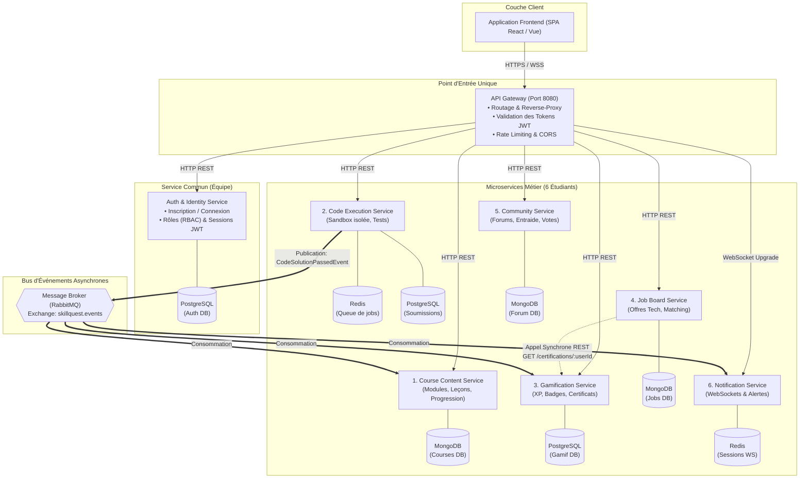

# Architecture du Projet – SkillQuest

## 1. Vue d'Ensemble du Projet

**SkillQuest** est une plateforme web distribuée orientée microservices combinant :
- **L'apprentissage interactif** (cours modulaires et exercices pratiques).
- **L'évaluation de code en temps réel** (exécution sécurisée et isolée en sandbox).
- **Le recrutement technique certifié** (chasse de profils basée sur des compétences vérifiées).

Le système repose sur une architecture **microservices indépendants**, avec découplage fort selon le principe **Database-per-Service** et une combinaison de communications synchrones (REST) et asynchrones (Event-Driven).

---

## 2. Diagramme d'Architecture Globale

---

## 3. Description des Composants

### 3.1. API Gateway
- **Rôle :** Point d'entrée unique de l'ensemble du trafic externe.
- **Responsabilités :**
  - Routage dynamique des requêtes vers le bon microservice.
  - Vérification et validation de la signature des tokens JWT.
  - Injection des headers d'identité (`X-User-Id`, `X-User-Role`) vers les services internes.
  - Sécurité périmétrique (CORS, Rate Limiting, pare-feu applicatif).

### 3.2. Service Commun : Auth & Identity Service
- **Rôle :** Gestion centrale des utilisateurs et de l'authentification.
- **Base de données :** **PostgreSQL** (garantie ACID, unicité des e-mails, relations strictes).
- **Responsabilités :**
  - Inscription, connexion, révocation et rafraîchissement des tokens.
  - Contrôle d'accès basé sur les rôles (RBAC) : `ROLE_STUDENT`, `ROLE_INSTRUCTOR`, `ROLE_RECRUITER`, `ROLE_ADMIN`.

### 3.3. Microservices Métier (1 par membre de l'équipe)

| # | Microservice | Responsabilité | Base de Données | Justification du choix de la BD |
| :---: | :--- | :--- | :--- | :--- |
| **1** | **Course Content** | Gestion du catalogue de formations, chapitres, leçons et suivi d'avancement. | **MongoDB** | Données documentaires semi-structurées et imbriquées (cours $\rightarrow$ chapitres $\rightarrow$ leçons). |
| **2** | **Code Execution** | Exécution de code dans une sandbox sécurisée (Docker éphémère sans réseau), évaluation des tests unitaires. | **Redis + PostgreSQL** | Redis pour la file d'attente (FIFO) des soumissions rapides, PostgreSQL pour l'historique pérenne des résultats. |
| **3** | **Gamification** | Calcul des points d'XP, gestion des paliers de niveaux, attribution de badges et émission de certificats PDF vérifiables. | **PostgreSQL** | Intégrité transactionnelle stricte pour éviter la duplication d'XP ou la fraude aux classements. |
| **4** | **Job Board** | Publication d'offres d'emploi tech, filtrage des candidats par compétences vérifiées et gestion des candidatures. | **MongoDB** | Recherche flexible par mots-clés, tags de compétences et critères hétérogènes. |
| **5** | **Community** | Forums d'entraide dédiés aux exercices, réponses imbriquées, votes d'utilité et partage de solutions de code. | **MongoDB** | Gestion naturelle des arborescences de commentaires et threads de discussion. |
| **6** | **Notification** | Diffusion d'alertes instantanées par WebSockets et envoi d'e-mails transactionnels (convocations, badges obtenus). | **Redis + MongoDB** | Redis pour la gestion en mémoire des sessions WebSockets actives, MongoDB pour l'historique des notifications. |

---

##  Modes de Communication

### 4.1. Communications Synchrones (HTTP REST)
Utilisées pour les requêtes de lecture et de consultation directe nécessitant un résultat immédiat :
- Le client appelle les endpoints via l'**API Gateway**.
- **Exemple inter-services :** Le *Job Board Service* effectue un appel direct `GET /api/certifications/{userId}` vers le *Gamification Service* pour valider instantanément les badges réels d'un candidat avant d'accepter une candidature.

### 4.2. Communications Asynchrones (Event-Driven via RabbitMQ)
Utilisées pour découpler les services, améliorer les performances et garantir la résilience du système :
- **Scénario :** Un apprenant soumet une solution de code qui valide tous les tests unitaires.
- **Flux d'événements :**
  1. Le `Code Execution Service` publie l'événement `CodeSolutionPassedEvent` sur le topic exchange de RabbitMQ.
  2. Le `Gamification Service` consomme cet événement, crédite +50 XP et débloque le badge correspondant.
  3. Le `Course Content Service` consomme l'événement et marque la leçon comme "Validée".
  4. Le `Notification Service` consomme l'événement et pousse instantanément une alerte WebSocket sur le navigateur du client.

---

## 5. Sécurité & Authentification

- **Format des tokens :** JSON Web Tokens (JWT) signés avec algorithme asymétrique ou HMAC-SHA256.
- **Cycle d'authentification :**
  1. L'utilisateur envoie ses identifiants à l'API Gateway $\rightarrow$ relayé à l'Auth Service.
  2. L'Auth Service génère un `access_token` (durée de vie courte : 15 min) et un `refresh_token` (durée de vie longue : 7 jours).
  3. Pour chaque requête subséquente, l'API Gateway intercepte le token dans le header `Authorization: Bearer <token>`, valide son authenticité, et enrichit la requête transmise aux microservices avec les en-têtes internes sécurisés `X-User-Id` et `X-User-Role`.
