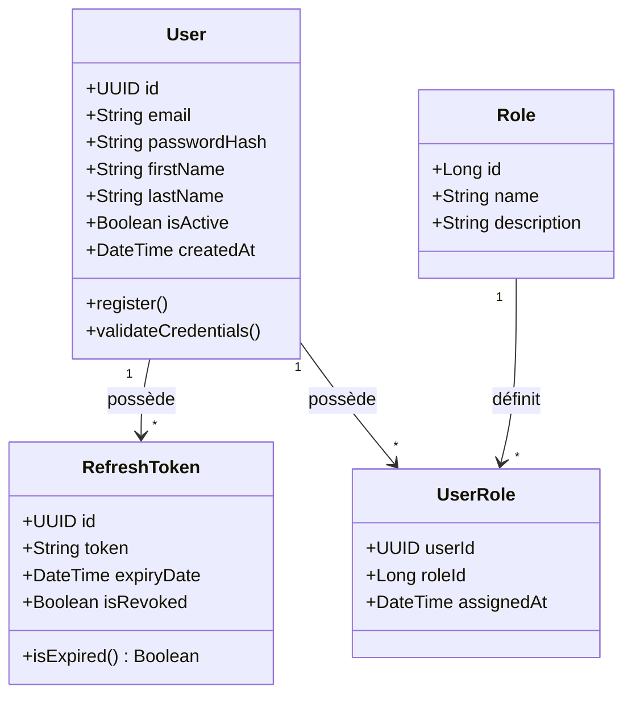
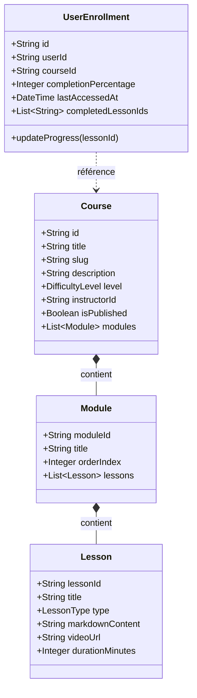
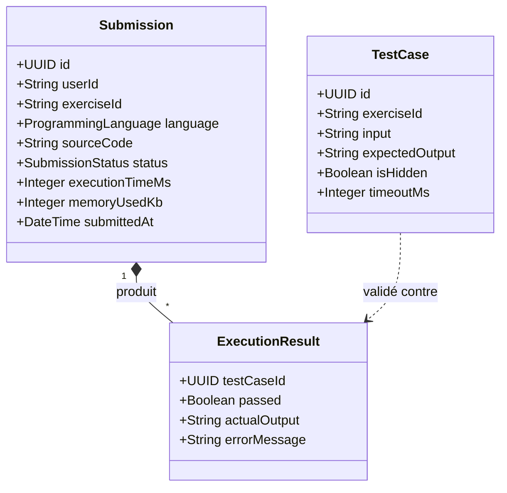
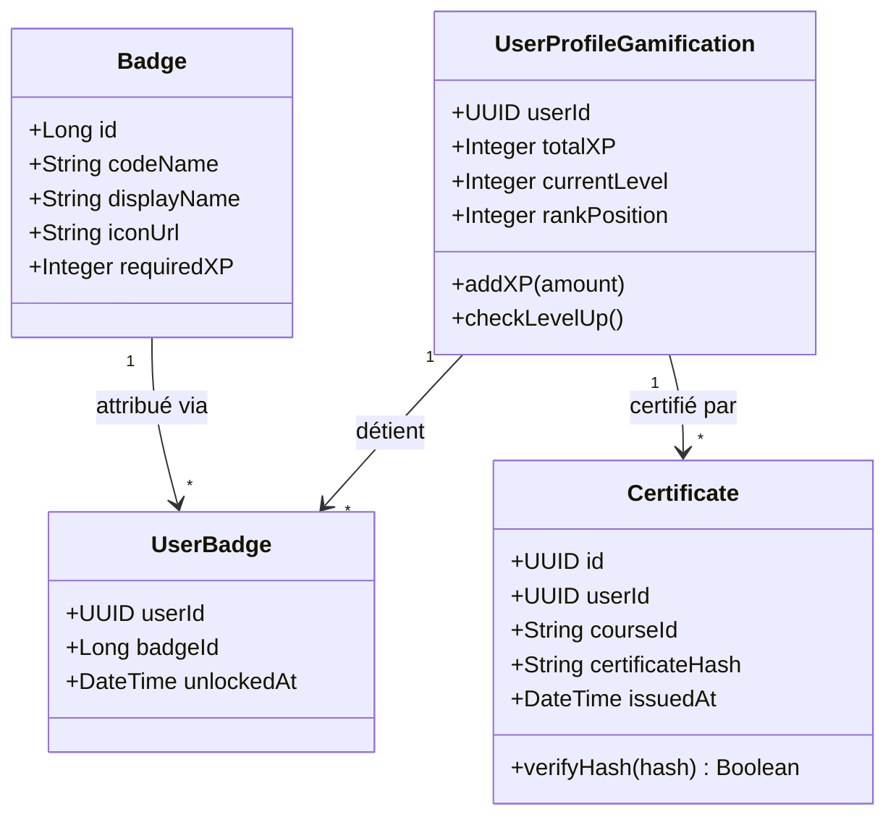
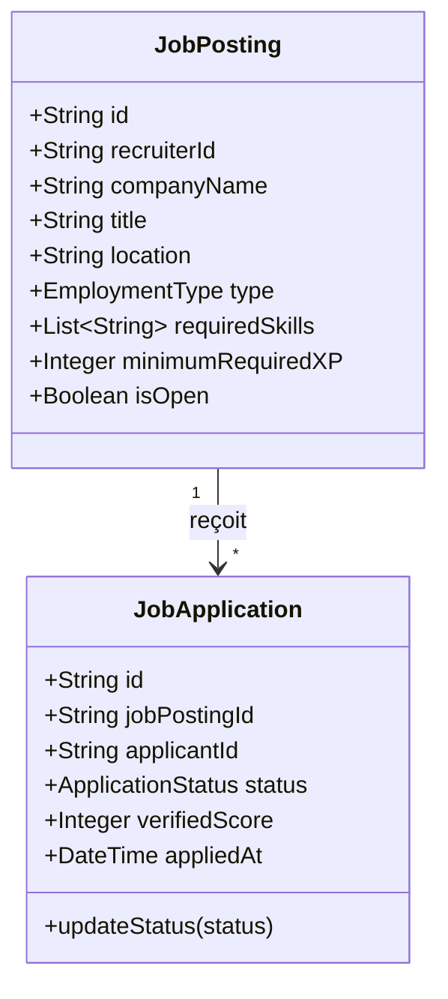
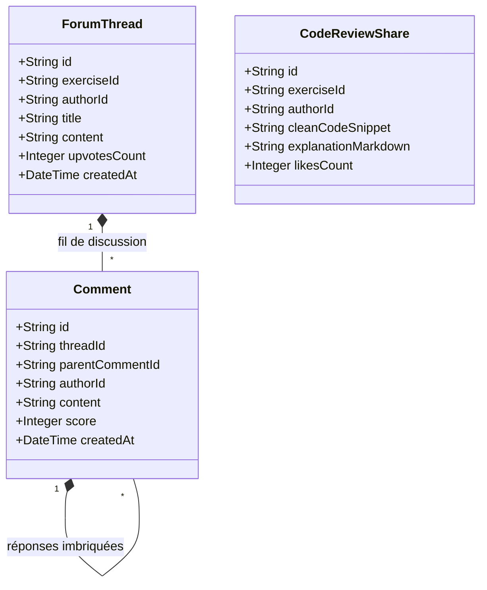

# Diagrammes de Classes UML – Microservices SkillQuest

Ce document détaille les modèles de classes internes pour chacun des microservices du projet, requis pour la présentation individuelle de la séance 4.

---

## 1. Service Commun : Auth & Identity Service (PostgreSQL)

---

## 2. Microservice 1 : Course & Learning Content Service (MongoDB)

---

## 3. Microservice 2 : Code Execution & Sandbox Service (Redis + PostgreSQL)

---

## 4. Microservice 3 : Gamification & Certification Service (PostgreSQL)

---

## 5. Microservice 4 : Job Board & Recruitment Service (MongoDB)

---

## 6. Microservice 5 : Community & Peer-Review Service (MongoDB)

