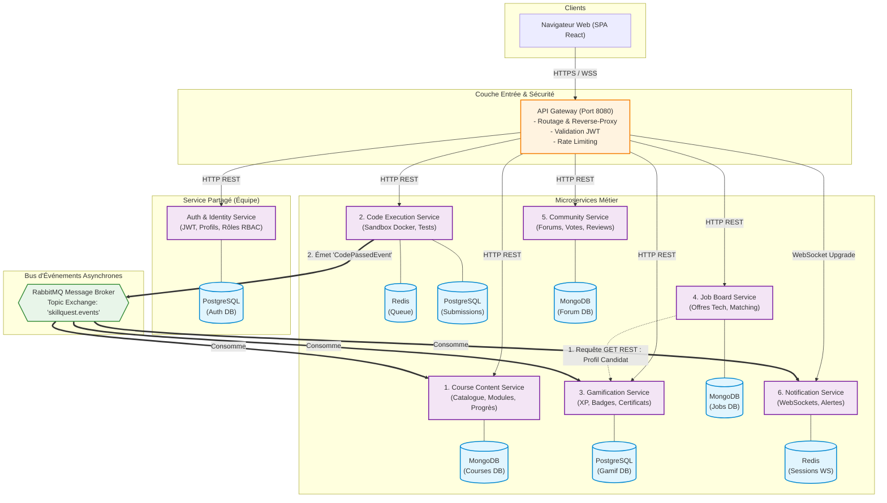
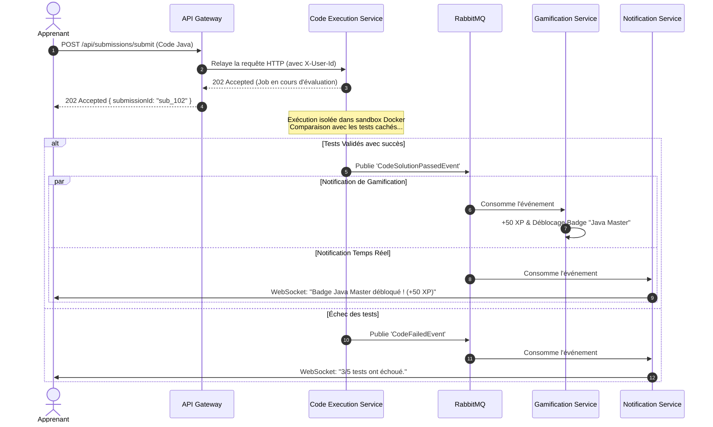

# Diagrammes d'Architecture du Projet SkillQuest

## 1. Diagramme d'Architecture Globale (Microservices & Communications)

---

## 2. Diagramme de Séquence : Traitement d'une Soumission de Code (Synchrone & Asynchrone)

