# Présentation Synthétique – Séance 4 (Validation Intermédiaire)
## Projet AWD : Architecture Web Distribuée

> **Projet :** SkillQuest – Plateforme d'Apprentissage & Recrutement IT  
> **Classe :** [Votre Classe, ex: 4DAS16] | **Groupe :** [Votre Groupe, ex: G3]  
> **Dépôt Git Collaboratif :** https://github.com/Architecture-web/projet  
> **Durée maximale de la présentation :** entre 10 et 15 minutes (Partie Groupe ~5 min + Partie Individuelle 6 x 1 min ~6 min)  
> **Discussion avec l'enseignant :** 10 minutes

---

## 🕒 Répartition du Temps de Soutenance (12 à 14 minutes)

```text
[00:00 - 05:30]  PARTIE GROUPE (Présentée collectivement par les membres)
                 ├── 1. Idée générale & problématique (acteurs & cas d'utilisation général)
                 ├── 2. Principales fonctionnalités
                 ├── 3. Architecture globale proposée (diagramme, services, gateway, sécurité, données & coms)
                 ├── 4. Microservices, responsabilités & choix de bases de données
                 ├── 5. Technologies choisies
                 ├── 6. Répartition des tâches entre les membres de l'équipe
                 ├── 7. Organisation du dépôt Git & outil de gestion du projet
                 ├── 8. Planning prévisionnel & principaux risques
                 └── 9. Autres aspects pertinents (stratégie Docker & résilience)

[05:30 - 12:30]  PARTIE INDIVIDUELLE (1 min de speech max par étudiant - Responsable du microservice)
                 ├── Microservice Commun : Auth & Identity Service (Présenté par Étudiant 1)
                 ├── Microservice 1 : Course & Learning Content Service (Étudiant 2)
                 ├── Microservice 2 : Code Execution & Sandbox Service (Étudiant 3)
                 ├── Microservice 3 : Gamification & Certification Service (Étudiant 4)
                 ├── Microservice 4 : Job Board & Recruitment Service (Étudiant 5)
                 └── Microservice 5 : Community & Peer-Review Service (Étudiant 6)

[12:30 - 22:30]  DISCUSSION & QUESTIONS-RÉPONSES AVEC L'ENSEIGNANT (10 minutes)
```

---

# 👥 PARTIE GROUPE (À réaliser par tous les membres du groupe)

---

### Slide 1 : L’idée générale et la problématique du projet proposé (acteurs et cas d’utilisation général)

#### 1. Problématique Métier
- **Limites des CV déclaratifs :** Dans l'industrie tech, un diplôme ou une liste de mots-clés sur un CV ne garantit pas la qualité réelle du code d'un candidat ni sa rigueur algorithmique.
- **Absence de preuves vérifiables :** Les étudiants peinent à démontrer concrètement leurs acquis pratiques auprès des entreprises.
- **Déconnexion des plateformes existantes :** Les plateformes de cours en ligne (style *Coursera*) sont séparées des sites d'exercices de code (style *LeetCode*) et des portails de recrutement (style *LinkedIn*).

#### 2. L'Idée Générale : SkillQuest
SkillQuest est un écosystème distribué complet qui unifie la **formation modulaire**, l'**évaluation de code dans une sandbox sécurisée** et le **recrutement certifié**.

#### 3. Acteurs & Cas d'Utilisation Général
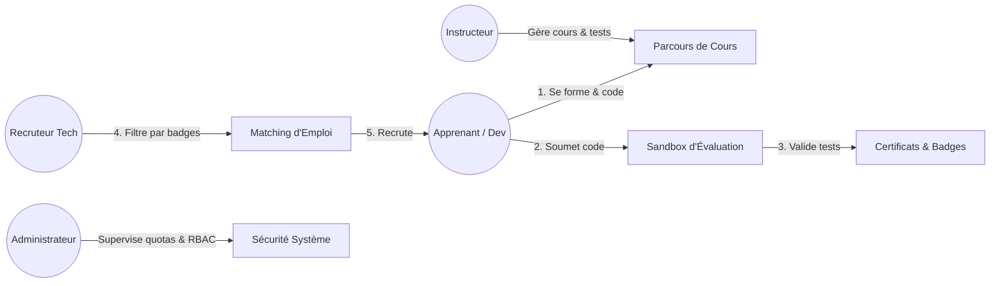

---

### Slide 2 : Les principales fonctionnalités

1. **Parcours Pédagogiques Modulaires :** Cours hiérarchisés en chapitres et leçons avec sauvegarde continue de l'avancement.
2. **Sandbox d'Évaluation de Code Sécurisée :** Conteneurs Docker éphémères sans accès réseau, bridés en RAM (128 Mo) et timeout (2s), validant le code contre des tests unitaires publics et secrets.
3. **Moteur d'Engagement & Gamification :** Crédit d'XP (+50 XP par exercice validé), déblocage automatique de badges de spécialité et classement en direct (*Leaderboard*).
4. **Certifications Numériques Vérifiables :** Diplômes PDF munis d'un hash cryptographique SHA-256 authentifiable publiquement en ligne.
5. **Espace Recrutement & Matching Automatisé :** Calcul de concordance entre les critères d'une offre d'emploi et les badges vérifiés du candidat.
6. **Entraide & Revue de Code entre Pairs (Peer-Review) :** Forums par exercice et comparaison des solutions après validation pour étudier les complexités algorithmiques.
7. **Alertes Temps Réel :** Connexion WebSocket pushant instantanément les validations de code et contacts recruteurs.

---

### Slide 3 : L’architecture globale proposée : diagramme global, services, API Gateway, sécurité, données et communications


#### Synthèse des Composants d'Architecture
- **API Gateway (Port 8080) :** Point d'entrée unique. Valide la signature des tokens JWT, applique le rate limiting, et propage les headers internes d'identité (`X-User-Id`, `X-User-Role`).
- **Sécurité Centralisée :** Authentification basée sur des tokens JWT courts (15 min) et refresh tokens longs (7 jours). Contrôle d'accès basé sur les rôles (RBAC).
- **Données Découplées :** Application stricte du patron **Database-per-Service** (aucune base partagée).
- **Communications Hybrides :** Synchrones (HTTP REST) pour les lectures directes sans persistance, Asynchrones (RabbitMQ) pour les événements métier à fort découplage.

---

### Slide 4 : Les microservices, leurs responsabilités et les choix de bases de données

| Microservice | Port | Responsabilité Majeure | Base de Données | Justification Technique du Choix de Base |
| :--- | :---: | :--- | :--- | :--- |
| **Auth & Identity** *(Commun)* | `8081` | Authentification, JWT, rôles RBAC, sécurité | **PostgreSQL 15** | Conformité ACID stricte, contrainte d'unicité des e-mails, relations comptes/rôles. |
| **1. Course Content** | `8082` | Catalogue de cours, modules, leçons, avancement | **MongoDB 6.0** | Structure arborescente polymorphe naturelle (cours $\rightarrow$ chapitres $\rightarrow$ leçons) sans jointures relationnelles. |
| **2. Code Execution** | `8083` | Sandbox Docker isolée, évaluation des tests | **Redis 7 + PgSQL** | Redis pour la file d'attente FIFO ultra-rapide des jobs ; PostgreSQL pour l'historique pérenne des résultats. |
| **3. Gamification** | `8084` | Points d'XP, badges, Leaderboard, certificats | **PostgreSQL 15** | Intégrité transactionnelle absolue pour éviter toute fraude de points ou duplication de récompenses. |
| **4. Job Board** | `8085` | Dépôt d'offres tech, matching automatisé | **MongoDB 6.0** | Indexation multi-critères souple pour tags de langages et compétences hétérogènes. |
| **5. Community** | `8086` | Forums par exercice, votes, Peer-Review | **MongoDB 6.0** | Modélisation performante des commentaires imbriqués et arborescences de discussion. |
| **6. Notification** | `8087` | Alertes WebSockets temps réel & e-mails | **Redis 7 + Mongo** | Redis pour le registre des sessions WebSockets actives en mémoire ; MongoDB pour l'historique des alertes. |

---

### Slide 5 : Les technologies choisies

- **Client Web (Frontend) :** React.js (SPA réactive), TailwindCSS (design épuré), Monaco Editor (éditeur de code en ligne) et client WebSocket persistant.
- **Passerelle & Backend :** Spring Cloud Gateway ou Express Gateway (Port 8080) ; Microservices développés en Spring Boot (Java) ou Node.js / TypeScript.
- **Bases de Données Polyglottes :** PostgreSQL 15 (SQL relationnel ACID), MongoDB 6.0 (NoSQL orienté documents), Redis 7 (In-Memory Key-Value / Pub-Sub).
- **Message Broker :** RabbitMQ 3.8 (Protocole AMQP avec Topic Exchange `skillquest.events`).
- **Conteneurisation & Isolation :** Docker, Docker-Compose et conteneurs éphémères pour la sandbox sans droits root.

---

### Slide 6 : La répartition des tâches entre les membres de l’équipe

| Membre | Microservice Attribué | Rôle & Responsabilité Principale | Tâches Transverses Réalisées |
| :--- | :--- | :--- | :--- |
| **Étudiant 1** *(Lead)* | **Auth & Identity Service** *(Commun)* | Authentification, JWT, rôles RBAC, configuration Gateway | Initialisation du dépôt Git, architecture globale |
| **Étudiant 2** | **1. Course Content Service** | Arborescence MongoDB, modules, suivi de progression | Rédaction des spécifications et modèles de données |
| **Étudiant 3** | **2. Code Execution Service** | Sandbox Docker, quotas mémoire/CPU, file Redis | Configuration du broker RabbitMQ et schéma d'événements |
| **Étudiant 4** | **3. Gamification Service** | Calcul d'XP, badges, certificats PDF avec hash SHA-256 | Contrats d'API REST inter-services et codes retour |
| **Étudiant 5** | **4. Job Board Service** | Offres tech, algorithme de matching profil/offre | Maquettes Frontend et intégration des formulaires |
| **Étudiant 6** | **5. Community & Notif Service**| Forums, Peer-Review, sessions WebSockets en direct | Support de présentation et documentation Markdown |

---

### Slide 7 : L’organisation du dépôt Git et l’outil de gestion du projet

- **Structure Arborescente du Dépôt :**
  ```text
  ├── Backend/                # 8 sous-dossiers de services avec README dédié
  ├── Frontend/               # Application cliente SPA
  └── Documentation/
      ├── Architecture.md     # Description technique détaillée
      ├── Diagrams/           # 15 diagrammes Mermaid (global, classes, interactions)
      └── Presentation/       # Slides et scripts oraux de soutenance
  ```
- **Stratégie de Branches (Git Flow) :**
  - Branche `main` protégée (seul du code stable et testé y est mergé).
  - Branches de fonctionnalités isolées : `feature/auth-jwt`, `feature/sandbox-eval`, etc.
  - Revues de code systématiques (Pull Requests) validées par au moins un pair.
- **Dépôt Public & Collaboration Enseignant :**
  - Dépôt : `https://github.com/Architecture-web/projet` avec l'enseignant invité en tant que collaborateur.
- **Outil de Gestion de Projet :**
  - **GitHub Projects / Trello** (méthode Kanban) : *To Do* $\rightarrow$ *In Progress* $\rightarrow$ *Review (PR)* $\rightarrow$ *Done*.

---

### Slide 8 : Le planning prévisionnel et les principaux risques

#### 1. Planning Prévisionnel par Jalons
- **Jalon 1 (Séance 4 - Validation Intermédiaire) :** Architecture validée, modèles de données, diagrammes UML et contrats d'API formalisés.
- **Jalon 2 (Semaines 5-6) :** Développement unitaire de chaque microservice et persistance des bases dédiées.
- **Jalon 3 (Semaines 7-8) :** Intégration de l'API Gateway, bus RabbitMQ et développement de l'interface client.
- **Jalon 4 (Semaine 9 - Validation Finale) :** Tests d'intégration de bout en bout, conteneurisation Docker-Compose finale et soutenance.

#### 2. Matrice des Risques Majeurs & Solutions
| Risque Identifié | Impact | Probabilité | Mesure Préventive & Solution de Contournement |
| :--- | :---: | :---: | :--- |
| **Exécution de code malveillant / boucle infinie (Sandbox)** | Élevé | Moyenne | Isolation stricte dans un conteneur éphémère sans accès réseau, CPU bridé, mémoire max 128 Mo et timeout dur de 2 secondes. |
| **Désynchronisation des données inter-services** | Élevé | Faible | Contrats d'API stricts (OpenAPI), événements idempotents sur RabbitMQ et mécanisme de compensation. |
| **Retard sur l'intégration du Frontend client** | Moyen | Moyenne | Spécification complète des contrats d'API dès la séance 4 permettant aux développeurs frontend de mocker les APIs. |

---

### Slide 9 : Autres aspects pertinents (Stratégie Docker & Résilience)

- **Orchestration Docker Locale (`docker-compose.yml`) :** Déploiement automatisé d'un clic des 4 conteneurs d'infrastructure : PostgreSQL (`5432`), MongoDB (`27017`), Redis (`6379`) et RabbitMQ avec console d'administration Web (`15672`).
- **Tolérance aux Pannes & Résilience :**
  - Si le service de notification ou de gamification est temporairement arrêté, les messages s'accumulent dans les files durables de RabbitMQ sans aucune perte de données.
  - Dès le redémarrage du service, les messages sont consommés et traités séquentiellement.

---

# 🎤 PARTIE INDIVIDUELLE (1 minute de speech maximum par étudiant)

---

## 👤 ÉTUDIANT 1 : Microservice Commun – Auth & Identity Service (Port 8081)

### 1. Conception & Diagramme de Classes
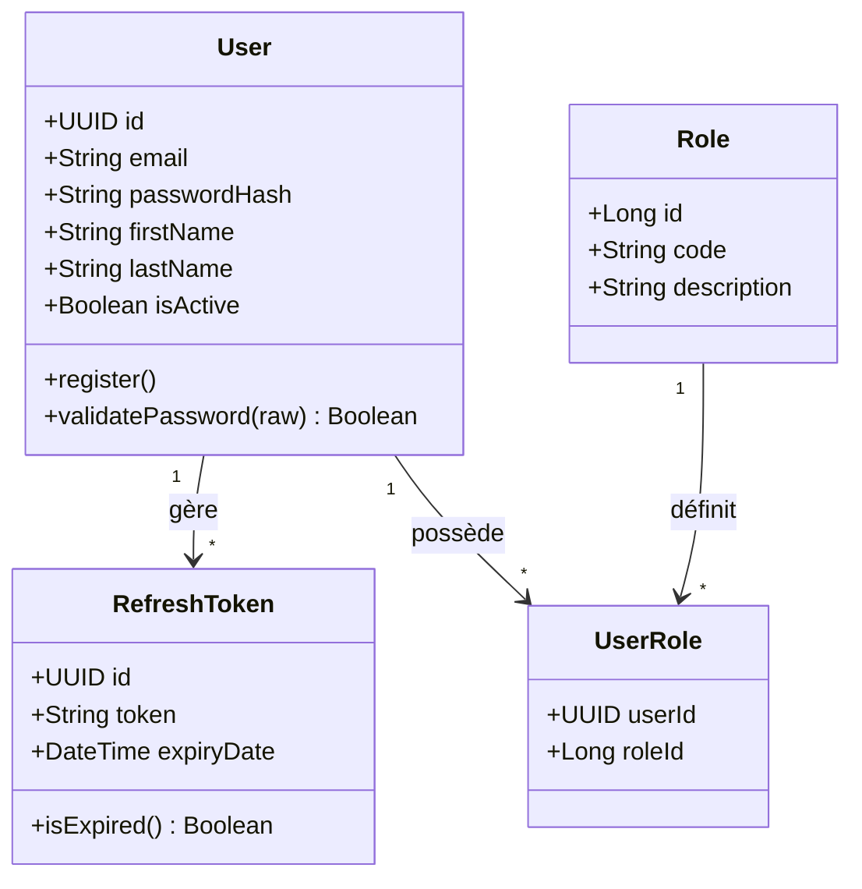
- **Base de données :** **PostgreSQL 15** (`skillquest_auth`) pour la conformité ACID et l'unicité stricte des e-mails.

### 2. Interactions Synchrones & Asynchrones
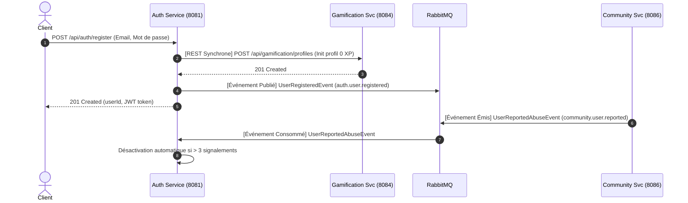
- **Communication Synchrone REST (Émise) :** `POST http://localhost:8084/api/gamification/profiles` pour créer immédiatement le compte joueur de l'apprenant à l'inscription.
- **Communication Synchrone REST (Reçue) :** Expose `GET /api/auth/users/:id/summary` appelé par `course-service` et `community-service` pour obtenir le nom et l'avatar de l'auteur.
- **Événement Métier Publié :** `UserRegisteredEvent` sur le topic `auth.user.registered`.
- **Événement Métier Consommé :** `UserReportedAbuseEvent` émis par `community-service` pour suspendre automatiquement les comptes signalés.

### 3. Principaux Contrats d'API
| Méthode | Endpoint | Description | Code Succès |
| :--- | :--- | :--- | :---: |
| `POST` | `/api/auth/register` | Inscription d'un utilisateur | `201 Created` |
| `POST` | `/api/auth/login` | Authentification & émission JWT | `200 OK` |
| `POST` | `/api/auth/refresh` | Renouvellement de l'access token | `200 OK` |
| `GET` | `/api/auth/users/:id/summary` | Profil résumé inter-services | `200 OK` |

### 🎙️ Speech Oral Étudiant 1 (Chronométré 1 minute)
> *"Bonjour à tous. Je présente le service commun d'authentification et d'identité conçu pour sécuriser l'ensemble de la plateforme. Sa mission est d'assurer la gestion des comptes, le hachage des mots de passe en BCrypt et la distribution des tokens JWT avec contrôle d'accès RBAC. Nous avons retenu PostgreSQL pour garantir l'intégrité relationnelle et l'unicité stricte des comptes.*  
> *Concernant mes interactions, dès qu'un utilisateur s'enregistre, mon service effectue un appel synchrone REST vers le Gamification Service pour initialiser son solde de points, puis publie l'événement UserRegisteredEvent sur RabbitMQ pour déclencher l'envoi du courriel de confirmation.*  
> *En consommation asynchrone, j'écoute UserReportedAbuseEvent en provenance du Community Service pour bloquer automatiquement les comptes auteurs de comportements malveillants. Merci."*

---

## 👤 ÉTUDIANT 2 : Microservice 1 – Course & Learning Content Service (Port 8082)

### 1. Conception & Diagramme de Classes
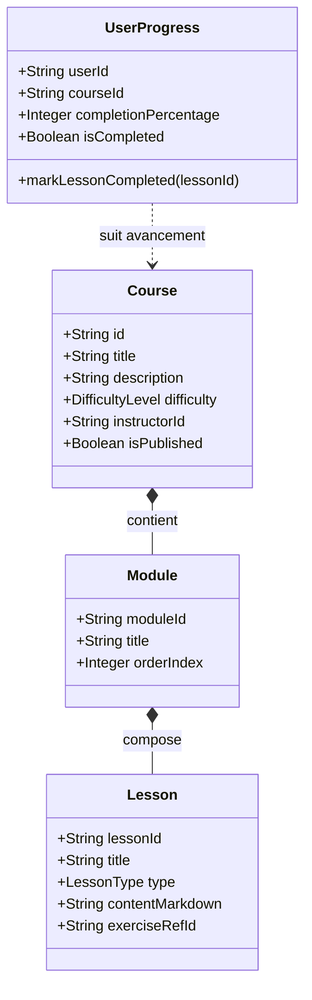
- **Base de données :** **MongoDB 6.0** (`skillquest_courses`) car l'arborescence des cours et leçons s'enregistre naturellement en documents JSON hiérarchisés sans jointures.

### 2. Interactions Synchrones & Asynchrones
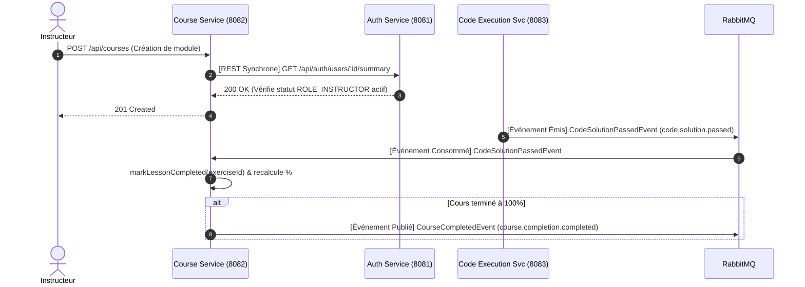
- **Communication Synchrone REST (Émise) :** `GET http://localhost:8081/api/auth/users/:instructorId/summary` pour valider en temps réel le statut actif de l'instructeur lors du dépôt d'un cours.
- **Communication Synchrone REST (Reçue) :** Expose `GET /api/courses/:id/exercises/:eId/test-cases` appelé par la sandbox de code pour charger les jeux d'essais.
- **Événement Métier Publié :** `CourseCompletedEvent` sur le topic `course.completion.completed` dès qu'un apprenant termine 100% des modules.
- **Événement Métier Consommé :** `CodeSolutionPassedEvent` (émis par `code-execution-service`) pour valider automatiquement la leçon pratique dans le suivi de l'étudiant.

### 3. Principaux Contrats d'API
| Méthode | Endpoint | Description | Code Succès |
| :--- | :--- | :--- | :---: |
| `GET` | `/api/courses` | Liste paginée des cours avec filtres | `200 OK` |
| `GET` | `/api/courses/:id` | Détail complet d'un cours et de son plan | `200 OK` |
| `POST` | `/api/courses` | Création d'une formation (Instructeur) | `201 Created` |
| `PUT` | `/api/courses/:id/progress` | Sauvegarde de l'avancement | `200 OK` |
| `GET` | `/api/courses/:id/exercises/:eId/test-cases` | Fournit les tests à la sandbox (interne) | `200 OK` |

### 🎙️ Speech Oral Étudiant 2 (Chronométré 1 minute)
> *"Bonjour. Je suis responsable du Course Content Service, le module d'apprentissage de SkillQuest. Il gère le catalogue pédagogique, la structuration des cours en modules et le suivi d'avancement de chaque apprenant. J'ai sélectionné MongoDB car sa structure documentaire permet d'imbriquer des leçons théoriques, vidéos et exercices sans subir la lourdeur de jointures SQL.*  
> *Pour mes interactions, j'émets une requête synchrone REST vers l'Auth Service pour certifier le rôle instructeur lors de la publication d'un cours. En asynchrone, mon service consomme CodeSolutionPassedEvent pour valider automatiquement les étapes pratiques de l'élève.*  
> *Enfin, lorsqu'un cours atteint 100% de complétion, je publie l'événement CourseCompletedEvent sur RabbitMQ afin que le service de gamification émette le diplôme officiel de l'élève. Merci."*

---

## 👤 ÉTUDIANT 3 : Microservice 2 – Code Execution & Sandbox Service (Port 8083)

### 1. Conception & Diagramme de Classes
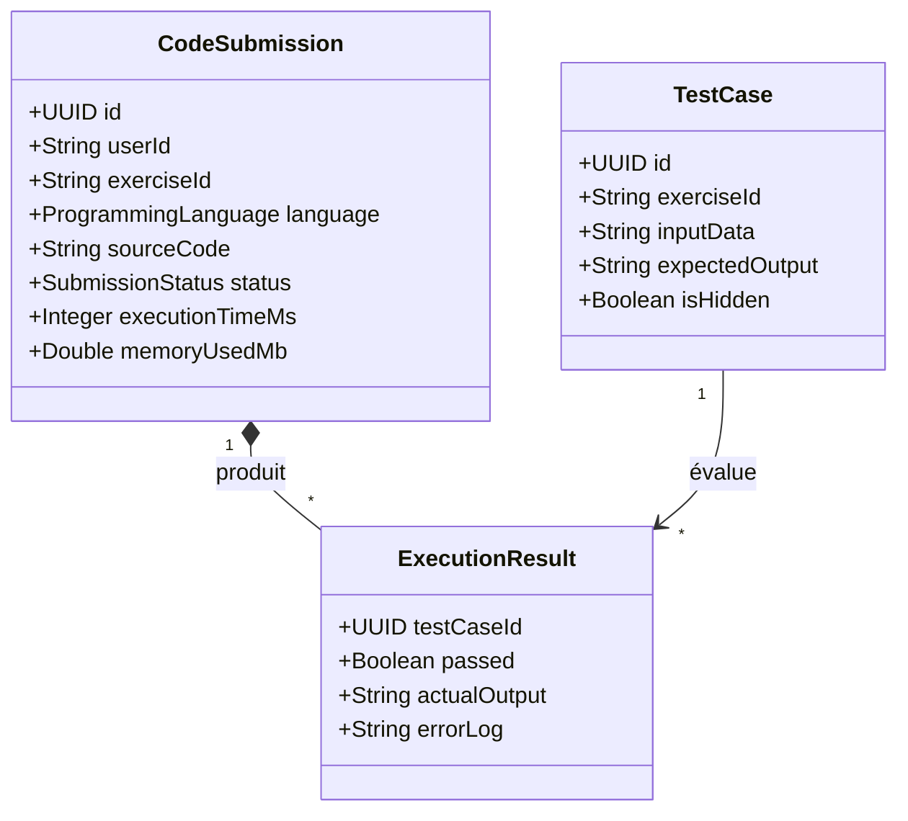
- **Bases de données :** **Redis 7** (file d'attente FIFO) pour absorber les pics d'évaluation de code sans bloquer le serveur + **PostgreSQL 15** (`skillquest_submissions`) pour archiver les traces et métriques d'exécution.

### 2. Interactions Synchrones & Asynchrones
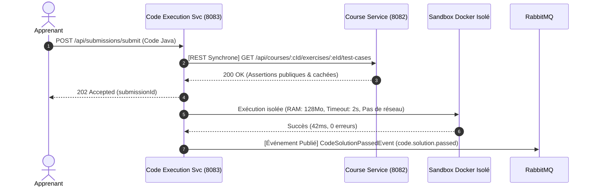
- **Communication Synchrone REST (Émise) :** `GET http://localhost:8082/api/courses/:cId/exercises/:eId/test-cases` pour charger les assertions avant exécution (la sandbox ne stocke aucun contenu pédagogique).
- **Événement Métier Publié :** `CodeSolutionPassedEvent` sur le topic `code.solution.passed` dès que tous les tests secrets réussissent.
- **Événement Métier Consommé :** `ExerciseCreatedEvent` émis par `course-service` sur `code_exec.exercise_created.queue` pour pré-charger les runtimes de compilation (Java/Python).

### 3. Principaux Contrats d'API
| Méthode | Endpoint | Description | Code Succès |
| :--- | :--- | :--- | :---: |
| `POST` | `/api/submissions/run` | Test rapide contre assertions publiques | `200 OK` |
| `POST` | `/api/submissions/submit` | Soumission définitive évaluée en tâche de fond | `202 Accepted` |
| `GET` | `/api/submissions/:id` | Statut de l'évaluation et métriques CPU/RAM | `200 OK` |

### 🎙️ Speech Oral Étudiant 3 (Chronométré 1 minute)
> *"Bonjour. Mon microservice est le moteur technique d'évaluation pratique de la plateforme. Il reçoit le code soumis par les étudiants et l'évalue dans une sandbox Docker éphémère totalement isolée : aucun accès réseau, mémoire bridée à 128 Mo et timeout dur de 2 secondes contre les boucles infinies. J'utilise Redis pour la file d'attente FIFO des soumissions et PostgreSQL pour l'historique pérenne des résultats.*  
> *Pour les échanges inter-services, j'interroge en direct le Course Service via REST pour charger les tests unitaires avant exécution. Dès qu'une soumission passe avec succès l'ensemble des tests cachés, je publie l'événement pivot CodeSolutionPassedEvent sur RabbitMQ.*  
> *En consommation, j'écoute ExerciseCreatedEvent pour pré-charger les environnements d'exécution à chaud. Merci."*

---

## 👤 ÉTUDIANT 4 : Microservice 3 – Gamification & Certification Service (Port 8084)

### 1. Conception & Diagramme de Classes
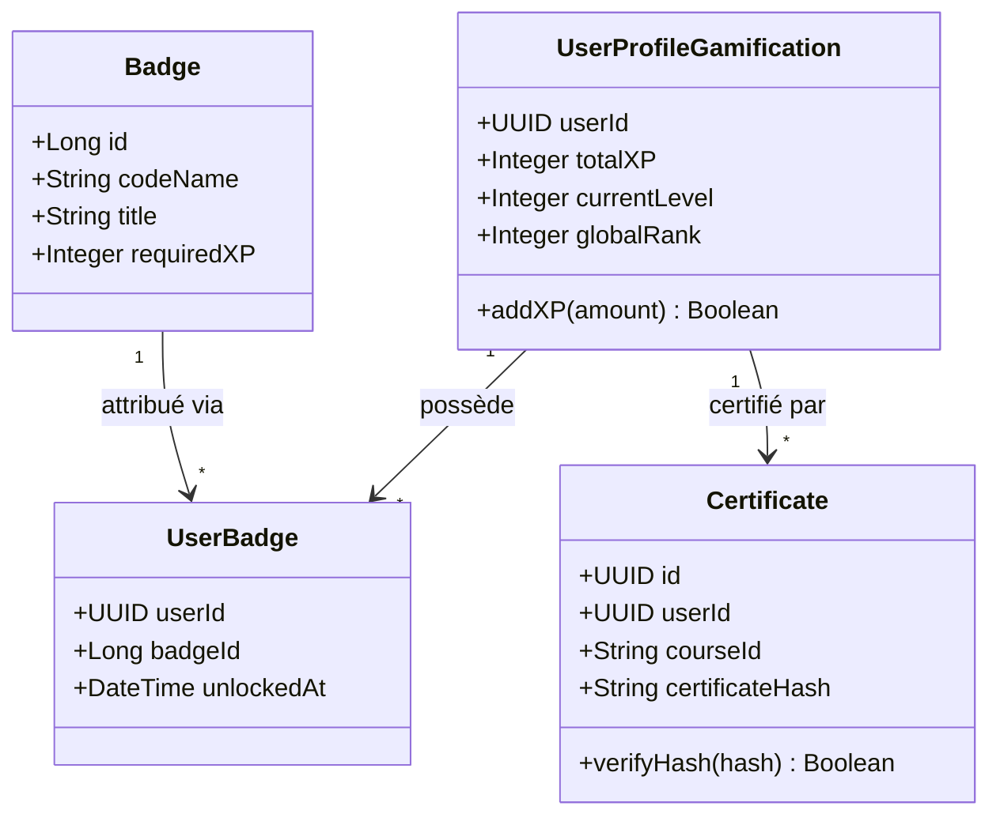
- **Base de données :** **PostgreSQL 15** (`skillquest_gamification`) pour garantir l'intégrité transactionnelle des points d'XP et l'unicité cryptographique des certificats émis.

### 2. Interactions Synchrones & Asynchrones
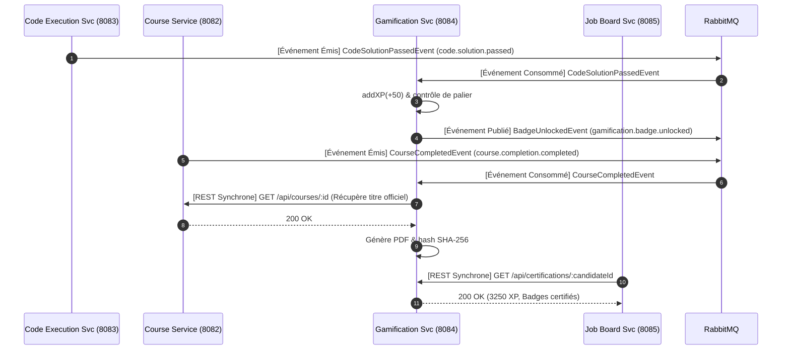
- **Communication Synchrone REST (Émise) :** `GET http://localhost:8082/api/courses/:id` auprès de `course-service` pour obtenir le titre officiel du cours lors de la signature du certificat PDF.
- **Communication Synchrone REST (Reçue) :** Expose `GET /api/certifications/:userId` sollicité en direct par le Job Board pour attester des compétences d'un candidat.
- **Événement Métier Publié :** `BadgeUnlockedEvent` sur le topic `gamification.badge.unlocked`.
- **Événements Métiers Consommés :** `CodeSolutionPassedEvent` (+50 XP) et `CourseCompletedEvent` (déclenche la création du certificat numérique).

### 3. Principaux Contrats d'API
| Méthode | Endpoint | Description | Code Succès |
| :--- | :--- | :--- | :---: |
| `GET` | `/api/gamification/leaderboard` | Top 50 des meilleurs codeurs par XP | `200 OK` |
| `GET` | `/api/gamification/badges/user/:id`| Badges débloqués par un élève | `200 OK` |
| `GET` | `/api/certifications/:userId` | Profil certifié (appelé par Job Board) | `200 OK` |
| `GET` | `/api/certifications/:id/verify`| Vérification publique du hash PDF | `200 OK` |

### 🎙️ Speech Oral Étudiant 4 (Chronométré 1 minute)
> *"Bonjour. Je suis en charge du Gamification & Certification Service, le moteur d'engagement de SkillQuest. Il gère la distribution des points d'XP, les badges de spécialité, le classement général et la génération de certificats PDF signés par un hash cryptographique vérifiable en ligne. J'ai choisi PostgreSQL pour garantir l'intégrité transactionnelle stricte et empêcher toute fraude aux scores.*  
> *Mon service écoute CodeSolutionPassedEvent pour créditer instantanément 50 XP. Quand un palier est franchi, il publie BadgeUnlockedEvent à destination du Job Board et des notifications.*  
> *En synchrone, je réponds aux requêtes REST du Job Board pour fournir les compétences certifiées du candidat, et j'interroge le Course Service pour récupérer les métadonnées officielles lors de l'émission d'un diplôme. Merci."*

---

## 👤 ÉTUDIANT 5 : Microservice 4 – Job Board & Recruitment Service (Port 8085)

### 1. Conception & Diagramme de Classes
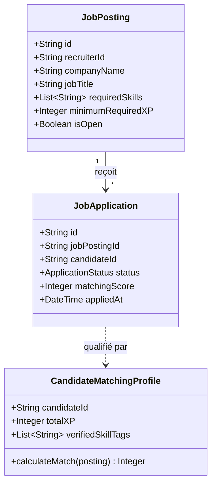
- **Base de données :** **MongoDB 6.0** (`skillquest_jobs`) pour modéliser des annonces riches avec indexation multi-critères sur les compétences et les salaires.

### 2. Interactions Synchrones & Asynchrones
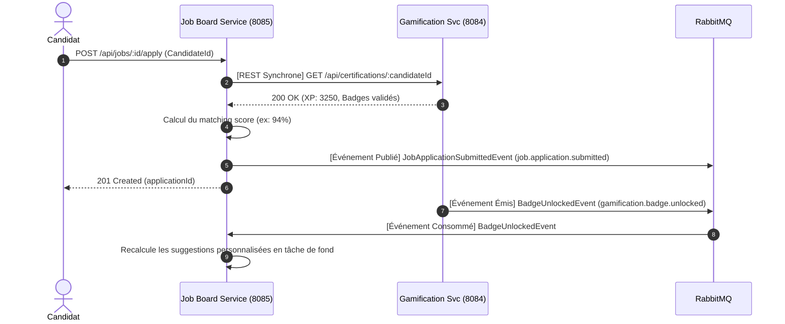
- **Communication Synchrone REST (Émise) :** `GET http://localhost:8084/api/certifications/:candidateId` pour authentifier les compétences du candidat auprès du service Gamification sans stocker de doublons.
- **Événement Métier Publié :** `JobApplicationSubmittedEvent` sur le topic `job.application.submitted` pour notifier instantanément le recruteur.
- **Événement Métier Consommé :** `BadgeUnlockedEvent` émis par `gamification-service` pour recalculer les scores de matching des offres ouvertes.

### 3. Principaux Contrats d'API
| Méthode | Endpoint | Description | Code Succès |
| :--- | :--- | :--- | :---: |
| `POST` | `/api/jobs` | Dépôt d'une offre d'emploi (Recruteur) | `201 Created` |
| `GET` | `/api/jobs` | Recherche paginée des offres tech | `200 OK` |
| `GET` | `/api/jobs/matched` | Offres recommandées selon les badges | `200 OK` |
| `POST` | `/api/jobs/:id/apply` | Postulation certifiée (appel REST interne) | `201 Created` |

### 🎙️ Speech Oral Étudiant 5 (Chronométré 1 minute)
> *"Bonjour. Je suis responsable du Job Board & Recruitment Service. Ce service transforme les réussites académiques des étudiants en opportunités professionnelles réelles en automatisant le matching entre les offres d'entreprises et les badges techniques obtenus. J'ai opté pour MongoDB afin de modéliser des offres d'emploi riches avec indexation multi-critères sur les langages et compétences.*  
> *Lorsqu'un étudiant postule, mon service émet un appel synchrone REST vers le Gamification Service pour authentifier ses badges en temps réel et calculer son score d'adéquation.*  
> *Dès que la candidature est validée, je publie JobApplicationSubmittedEvent sur RabbitMQ pour alerter le recruteur. En consommation, j'écoute BadgeUnlockedEvent pour recalculer les offres suggérées dès qu'un élève monte en compétences. Merci."*

---

## 👤 ÉTUDIANT 6 : Microservice 5 – Community & Notifications Service (Ports 8086 & 8087)

### 1. Conception & Diagramme de Classes
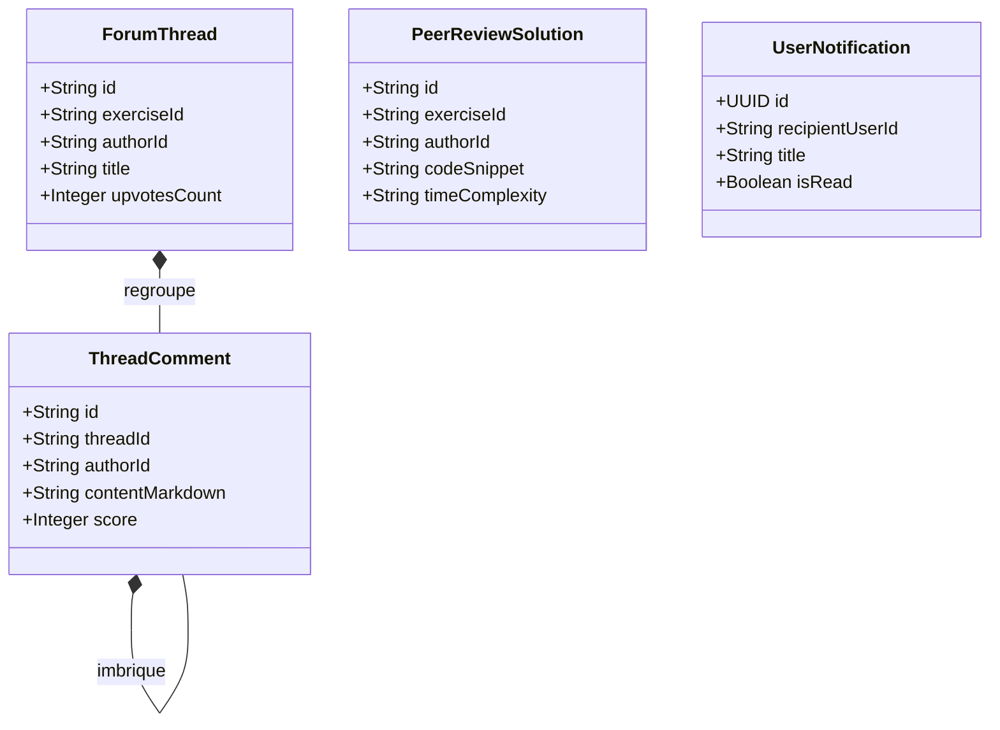
- **Bases de données :** **MongoDB 6.0** (`skillquest_community`) pour les arborescences de discussions + **Redis 7** pour les sessions WebSockets actives en mémoire.

### 2. Interactions Synchrones & Asynchrones
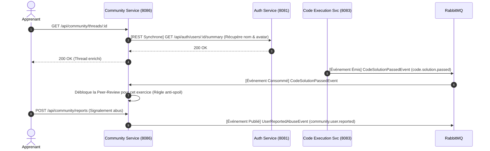
- **Communication Synchrone REST (Émise) :** `GET http://localhost:8081/api/auth/users/:id/summary` auprès de `auth-service` pour enrichir les posts avec les identités réelles des auteurs.
- **Événements Métiers Publiés :** `UserReportedAbuseEvent` vers l'Auth Service en cas de signalement grave et `HelpfulCommentVotedEvent`.
- **Événement Métier Consommé :** `CodeSolutionPassedEvent` (Queue: `community.code_passed.queue`) pour débloquer l'accès à la Peer-Review. Couplé au Notification Service pour diffuser les toasts WebSocket en direct (`WS /ws/notifications`).

### 3. Principaux Contrats d'API
| Méthode | Endpoint | Description | Code Succès |
| :--- | :--- | :--- | :---: |
| `GET` | `/api/community/threads?exerciseId={id}` | Questions d'un exercice | `200 OK` |
| `POST` | `/api/community/threads` | Création d'une discussion | `201 Created` |
| `POST` | `/api/community/posts/:id/vote` | Voter (+1 / -1) pour une explication | `200 OK` |
| `GET` | `/api/community/exercises/:id/peer-reviews` | Solutions partagées (si validé) | `200 OK` |
| `WS` | `/ws/notifications` | Canal persistant d'alertes en direct | `101 Switching` |

### 🎙️ Speech Oral Étudiant 6 (Chronométré 1 minute)
> *"Bonjour. Je présente le Community Service ainsi que la couche transverse de notifications temps réel. Notre service favorise l'émulation collective grâce à des espaces de questions/réponses contextuels et un module exclusif de revue de code entre pairs. J'ai choisi MongoDB pour stocker l'arborescence des commentaires imbriqués et Redis pour maintenir les sessions WebSockets actives.*  
> *Pour mes interactions, j'appelle en REST synchrone l'Auth Service pour afficher l'identité de l'auteur sans dupliquer ses données personnelles. En asynchrone, je consomme CodeSolutionPassedEvent : tant qu'un étudiant n'a pas résolu un défi, l'accès aux solutions des pairs lui est bloqué pour éviter le spoil.*  
> *Enfin, je publie UserReportedAbuseEvent vers l'Auth Service en cas d'abus signalé et je route les alertes instantanées vers le navigateur de l'élève. Merci."*

---

# ❓ DISCUSSION DE 10 MINUTES AVEC L'ENSEIGNANT (Questions Prévisibles & Arguments)

Pour vous préparer à la discussion de 10 minutes suivant la présentation, voici les notions de cours attendues :

1. **Pourquoi avoir choisi une architecture microservices plutôt qu'un monolithe ?**
   - *Réponse :* Scalabilité indépendante (la sandbox de compilation nécessite beaucoup de CPU/RAM alors que le catalogue de cours est principalement lu), isolation des pannes (si la sandbox plante, l'authentification et les cours restent accessibles) et déploiement polyglotte adapté aux compétences des 6 membres.
2. **Comment assurez-vous la cohérence des données sans transactions distribuées à deux phases (2PC) ?**
   - *Réponse :* Nous appliquons le principe d'**Éventuelle Cohérence (*Eventual Consistency*)** via RabbitMQ. Les événements sont idempotents (munis d'un `eventId` unique) pour éviter les effets de bord en cas de re-livraison.
3. **Pourquoi utiliser l'API Gateway plutôt que d'exposer directement les microservices ?**
   - *Réponse :* Point de terminaison unique pour le client (évite le CORS complexe et l'exposition de 8 ports publics), centralisation de la validation du token JWT et injection des headers de sécurité `X-User-Id` / `X-User-Role`.
