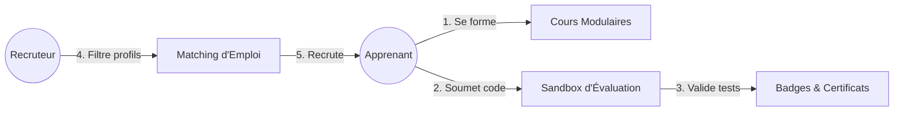
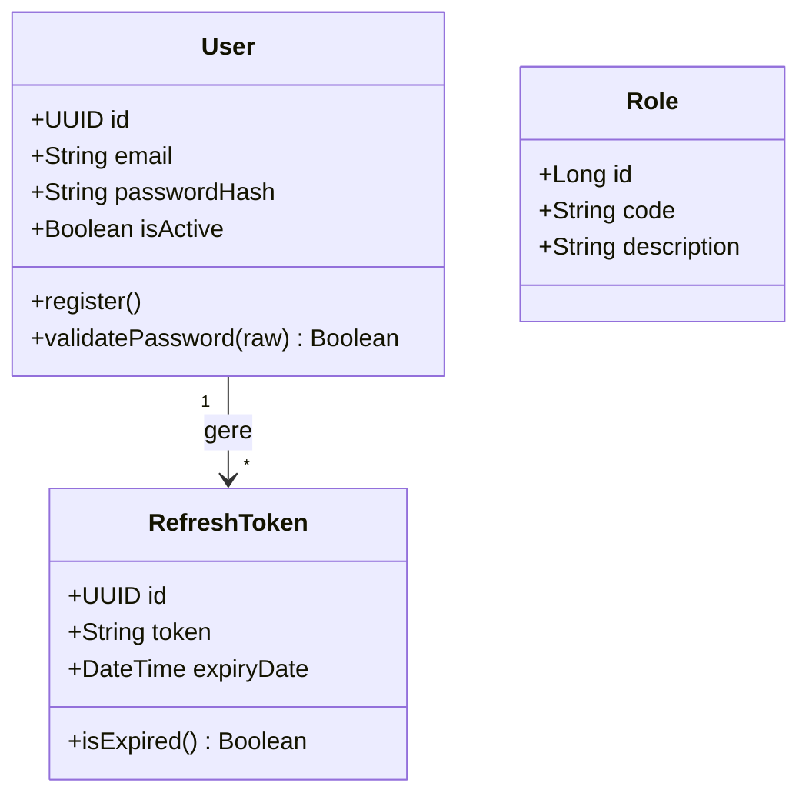
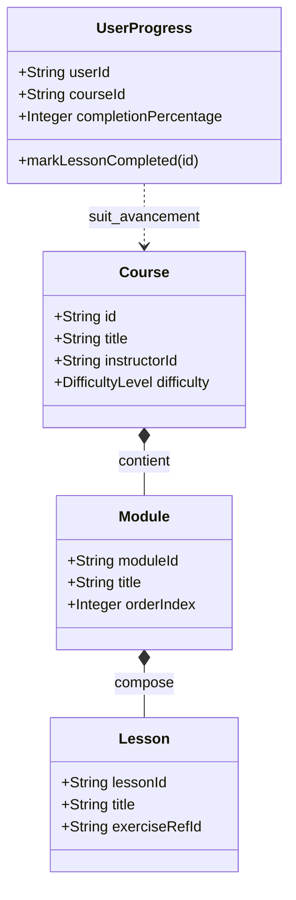
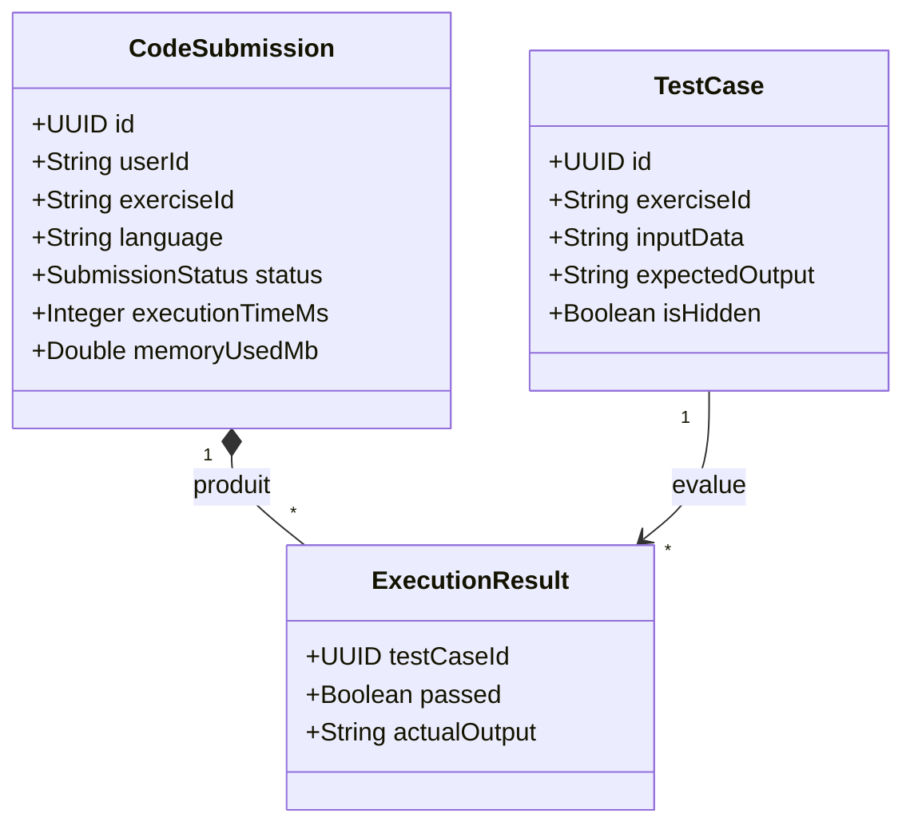
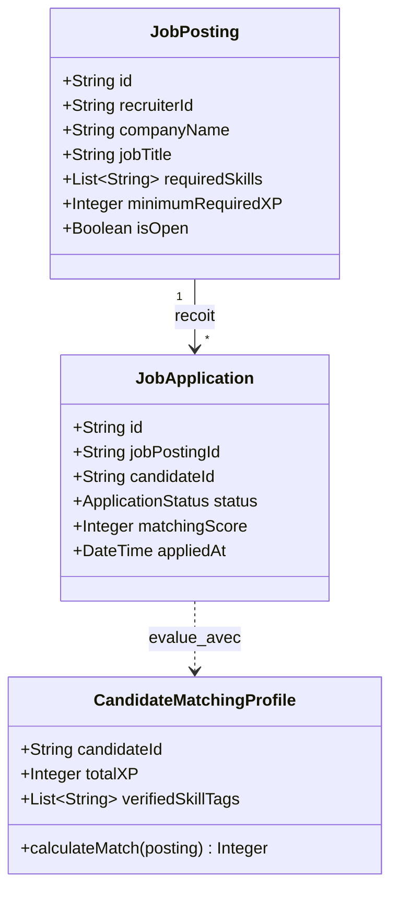
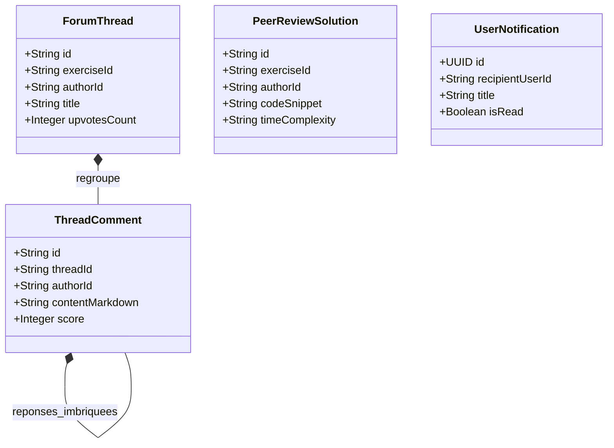

# Structure de la Présentation – Séance 4 (Validation Intermédiaire)
## Projet AWD : Architecture Web Distribuée (Projet SkillQuest)

> **Durée totale recommandée :** 12 à 14 minutes (Partie Groupe ~5 min + Partie Individuelle 6 x 1 min ~6 min + Conclusion ~1 min)  
> **Discussion avec l'enseignant :** 10 minutes  
> **Règle du sujet :** *"Chaque membre doit présenter obligatoirement son micro service. Les autres parties doivent être réparties équitablement entre les membres de l’équipe."*

---

## 👥 Matrice d'Assignation des Diapositives aux 6 Membres

| N° Diapo | Titre de la Diapositive | Section | 🎤 Membre Assigné | Durée estimée |
| :---: | :--- | :--- | :--- | :---: |
| **01** | **Page de Titre & Présentation** | Introduction | **Membre 1 (Lead)** | 45 sec |
| **02** | **Sommaire & Agenda de la Soutenance** | Sommaire | **Membre 2** | 30 sec |
| **03** | **Problématique & Idée Générale** | Partie Groupe | **Membre 3** | 45 sec |
| **04** | **Principales Fonctionnalités** | Partie Groupe | **Membre 4** | 45 sec |
| **05** | **Architecture Globale & API Gateway** | Partie Groupe | **Membre 5** | 1 min |
| **06** | **Microservices & Choix de Bases de Données** | Partie Groupe | **Membre 6** | 45 sec |
| **07** | **Technologies Choisies (Stack)** | Partie Groupe | **Membre 1** | 30 sec |
| **08** | **Répartition des Tâches entre les Membres** | Partie Groupe | **Membre 2** | 30 sec |
| **09** | **Organisation Git & Outil de Gestion** | Partie Groupe | **Membre 3** | 30 sec |
| **10** | **Planning Prévisionnel & Principaux Risques** | Partie Groupe | **Membre 4** | 30 sec |
| **11** | **Stratégie Docker & Résilience** | Partie Groupe | **Membre 5** | 30 sec |
| **12** | **Microservice Commun : Auth & Identity** | Partie Individuelle | **Membre 1** | **1 min max** |
| **13** | **Microservice 1 : Course Content** | Partie Individuelle | **Membre 2** | **1 min max** |
| **14** | **Microservice 2 : Code Execution Sandbox** | Partie Individuelle | **Membre 3** | **1 min max** |
| **15** | **Microservice 3 : Gamification & Certification**| Partie Individuelle | **Membre 4** | **1 min max** |
| **16** | **Microservice 4 : Job Board & Recruitment** | Partie Individuelle | **Membre 5** | **1 min max** |
| **17** | **Microservice 5 : Community & Notifications** | Partie Individuelle | **Membre 6** | **1 min max** |
| **18** | **Conclusion, Bilan & Perspectives** | Conclusion | **Membre 6** *(ou Collectif)* | 1 min |
| **19** | **Discussion & Questions avec l'Enseignant** | Échange (10 min) | **Tous les 6 Membres** | 10 min |

---

# 🖥️ DIAPOSITIVES – DÉROULÉ DÉTAILLÉ

---

## 🖥️ Diapositive 01 : Titre & Présentation du Projet
- **🎤 Membre Assigné :** Membre 1 (Lead de l'équipe)
- **⏱️ Durée :** 45 secondes

### Contenu Visuel à Projeter
- **Projet :** SkillQuest – Plateforme d'Apprentissage & Recrutement IT
- **Cours :** Architecture Web Distribuée (AWD) – Validation Intermédiaire (Séance 4)
- **Classe / Groupe :** [Ex: 4DAS16 - Groupe 3]
- **Équipe de 6 étudiants :**
  - Membre 1 : Auth & Identity Service *(Service Commun)*
  - Membre 2 : Course & Learning Content Service
  - Membre 3 : Code Execution & Sandbox Service
  - Membre 4 : Gamification & Certification Service
  - Membre 5 : Job Board & Recruitment Service
  - Membre 6 : Community & Notifications Service
- **Dépôt Git public :** `https://github.com/Architecture-web/projet` *(Enseignant ajouté en collaborateur)*

---

## 🖥️ Diapositive 02 : Sommaire de la Présentation

### Contenu Visuel à Projeter
```text
┌────────────────────────────────────────────────────────────────────────────────────────┐
│                                   SOMMAIRE GÉNÉRAL                                     │
├───────────────────────────────────────────────────┬────────────────────────────────────┤
│ I. PARTIE GROUPE (Collective – ~5 min)            │ II. PARTIE INDIVIDUELLE (~6 min)   │
│   1. Problématique & Idée Générale                │   • Diapo 12 : Membre 1 (Auth)     │
│   2. Principales Fonctionnalités                  │   • Diapo 13 : Membre 2 (Course)   │
│   3. Architecture Globale Proposée                │   • Diapo 14 : Membre 3 (CodeExec) │
│   4. Microservices & Choix de Bases de Données    │   • Diapo 15 : Membre 4 (Gamif)    │
│   5. Technologies Choisies (Stack)                │   • Diapo 16 : Membre 5 (Jobs)     │
│   6. Répartition des Tâches entre les Membres     │   • Diapo 17 : Membre 6 (Community)│
│   7. Organisation Git & Outils de Gestion         │                                    │
│   8. Planning Prévisionnel & Principaux Risques   │ III. CONCLUSION & PERSPECTIVES     │
│   9. Stratégie Docker & Résilience                │                                    │
│                                                   │ IV. DISCUSSION AVEC L'ENSEIGNANT   │
└───────────────────────────────────────────────────┴────────────────────────────────────┘
```

---

# 👥 PARTIE GROUPE (Collective)

---

## 🖥️ Diapositive 03 : 1. L’idée générale et la problématique du projet proposé


### Contenu Visuel à Projeter
- **Constat Métier :**
  - Un diplôme ou des mots-clés sur un CV ne garantissent pas la qualité réelle du code d'un candidat ni sa rigueur algorithmique.
  - Les étudiants manquent d'outils certifiants pour prouver concrètement leur niveau auprès des recruteurs.
  - Déconnexion totale entre plateformes de cours (Coursera), d'exercices (LeetCode) et de recrutement (LinkedIn).
- **Solution SkillQuest :** Une plateforme distribuée unifiant apprentissage modulaire, évaluation de code dans une sandbox isolée et portail de recrutement basé sur des compétences prouvées.
- **Acteurs :** Apprenant, Instructeur, Recruteur d'entreprise, Administrateur.



---

## 🖥️ Diapositive 04 : 2. Les principales fonctionnalités


### Contenu Visuel à Projeter
1. **Parcours Pédagogiques Modulaires :** Cours par niveaux avec chapitres, leçons vidéo/texte et sauvegarde temps réel de progression.
2. **Sandbox d'Évaluation de Code Sécurisée :** Conteneur Docker éphémère sans réseau (128 Mo RAM, timeout 2s) validant le code contre des tests unitaires publics et cachés.
3. **Moteur de Gamification :** Points d'XP (+50 XP/défi), niveaux, badges de spécialité et classement public en direct.
4. **Certifications Numériques Vérifiables :** Diplômes PDF signés par une empreinte cryptographique SHA-256 infalsifiable.
5. **Portail de Recrutement & Matching :** Concordance automatisée entre exigences des offres d'emploi et compétences réelles de l'élève.
6. **Entraide & Revue de Code (Peer-Review) :** Forums par exercice et comparaison des solutions après validation.
7. **Notifications Temps Réel :** Connexions WebSockets pour alerter en direct des réussites et des contacts d'entreprises.

---

## 🖥️ Diapositive 05 : 3. L’architecture globale proposée

### Contenu Visuel à Projeter


- **API Gateway (Port 8080) :** Point d'entrée unique, reverse-proxy, validation de signature JWT et injection des headers `X-User-Id` / `X-User-Role`.
- **Données Découplées :** Database-per-service (aucune base partagée entre microservices).
- **Communications Hybrides :** Synchrones (HTTP REST) pour les consultations directes et Asynchrones (RabbitMQ) pour les événements métier décorrélés dans le temps.


## 🖥️ Diapositive 06 : 4. Les microservices, leurs responsabilités et les choix de bases de données

### Contenu Visuel à Projeter
| Microservice | Port | Responsabilité Majeure | Base de Données | Justification Technique |
| :--- | :---: | :--- | :--- | :--- |
| **Auth & Identity** *(Commun)* | `8081` | Comptes, JWT, rôles RBAC | **PostgreSQL 15** | Conformité ACID stricte, contrainte d'unicité sur les e-mails. |
| **1. Course Content** | `8082` | Cours, modules, leçons, progression | **MongoDB 6.0** | Structure arborescente polymorphe sans jointures coûteuses. |
| **2. Code Execution** | `8083` | Sandbox Docker isolée, évaluation tests | **Redis 7 + PgSQL** | File FIFO ultra-rapide en mémoire + historique pérenne. |
| **3. Gamification** | `8084` | XP, badges, Leaderboard, certificats | **PostgreSQL 15** | Intégrité transactionnelle (anti-fraude de points). |
| **4. Job Board** | `8085` | Offres d'emploi tech, matching | **MongoDB 6.0** | Indexation souple multi-compétences et tags techniques. |
| **5. Community** | `8086` | Forums, votes, Peer-Review | **MongoDB 6.0** | Arborescences de commentaires et réponses imbriquées. |
| **6. Notification** | `8087` | WebSockets temps réel & e-mails | **Redis 7 + Mongo** | Sessions sockets actives en mémoire et historique persistant. |


## 🖥️ Diapositive 07 : 5. Les technologies choisies
- **🎤 Membre Assigné :** Membre 1
- **⏱️ Durée :** 30 secondes

### Contenu Visuel à Projeter
- **Frontend :** React.js (SPA), TailwindCSS, Monaco Editor (éditeur de code Web), client WebSocket natif.
- **Backend & Gateway :** Spring Cloud Gateway ou Express Gateway (Port 8080) ; Microservices en Spring Boot (Java) ou Node.js / TypeScript.
- **Bases de Données :** PostgreSQL 15, MongoDB 6.0, Redis 7.
- **Message Broker :** RabbitMQ 3.8 (AMQP, Topic Exchange `skillquest.events`).
- **DevOps & Conteneurisation :** Docker, Docker-Compose, conteneurs éphémères de sandbox bridés.


## 🖥️ Diapositive 08 : 6. La répartition des tâches entre les membres de l’équipe

### Contenu Visuel à Projeter
| Membre | Microservice Assigné | Responsabilités Métier | Contribution Transverse |
| :--- | :--- | :--- | :--- |
| **Membre 1 (Lead)** | **Auth & Identity Svc (Commun)** | JWT, BCrypt, rôles RBAC, Gateway | Initialisation Git & Architecture |
| **Membre 2** | **1. Course Content Service** | Modules MongoDB, progression | Modèles de données & Contrats |
| **Membre 3** | **2. Code Execution Service** | Sandbox Docker, quotas, file Redis | Configuration RabbitMQ |
| **Membre 4** | **3. Gamification Service** | Moteur d'XP, badges, certificats PDF | Contrats REST inter-services |
| **Membre 5** | **4. Job Board Service** | Offres tech, algorithme de matching | Maquettes Frontend & Formulaires |
| **Membre 6** | **5. Community & Notif Service**| Forums, Peer-Review, WebSockets | Documentation & Présentation |

### 🎙️ Ce que dit le Membre 2 à l'oral

---

## 🖥️ Diapositive 09 : 7. L’organisation du dépôt Git et l’outil de gestion du projet


### Contenu Visuel à Projeter
- **Structure Normalisée :** `Backend/` (8 sous-dossiers indépendants avec README dédié), `Frontend/`, `Documentation/` (Architecture, Diagrammes, Présentation).
- **Stratégie Git Flow :**
  - Branche `main` protégée (uniquement code stable et testé).
  - Branches de fonctionnalités isolées : `feature/auth-service`, `feature/sandbox-eval`, etc.
  - Pull Requests avec revue obligatoire par au moins un pair.
- **Collaboration Enseignant :** Dépôt public `https://github.com/Architecture-web/projet` avec l'enseignant invité comme collaborateur.
- **Outil de Gestion :** GitHub Projects / Trello (méthode Kanban) : *To Do* $\rightarrow$ *In Progress* $\rightarrow$ *Review (PR)* $\rightarrow$ *Done*.


---

## 🖥️ Diapositive 10 : 8. Le planning prévisionnel et les principaux risques


### Contenu Visuel à Projeter
- **Jalons Prévisionnels :**
  - *Jalon 1 (Séance 4) :* Validation intermédiaire de la conception, des diagrammes UML et des contrats d'API.
  - *Jalon 2 (Semaines 5-6) :* Implémentation unitaire de chaque microservice et persistance des bases.
  - *Jalon 3 (Semaines 7-8) :* Intégration Gateway, bus RabbitMQ et interface Frontend React.
  - *Jalon 4 (Semaine 9) :* Tests de charge, conteneurisation finale et soutenance.
- **Matrice des Risques :**
  - *Exécution de code malveillant :* Sandbox Docker sans réseau, RAM 128 Mo, timeout dur de 2 secondes.
  - *Désynchronisation des données :* Contrats d'API stricts, messages idempotents avec `eventId` sur RabbitMQ.
  - *Retard Frontend :* Mocks d'API disponibles dès la séance 4 grâce aux contrats d'API formalisés.

---

## 🖥️ Diapositive 11 : 9. Stratégie Docker & Résilience


### Contenu Visuel à Projeter
- **Orchestration Docker Locale (`docker-compose.yml`) :**
  - Déploiement d'un clic de l'infrastructure complète : PostgreSQL (`5432`), MongoDB (`27017`), Redis (`6379`) et RabbitMQ avec console d'administration (`15672`).
- **Tolérance aux Pannes & Résilience :**
  - Si un service consommateur (Notification, Gamification) est temporairement arrêté, les messages s'accumulent sans perte dans les files durables de RabbitMQ.
  - Au redémarrage du service, les événements sont traités automatiquement (*Eventual Consistency*).


---

# 🎤 PARTIE INDIVIDUELLE (1 minute de parole par étudiant)

---

## 🖥️ Diapositive 12 : Microservice Commun – Auth & Identity Service (Port 8081)
- **🎤 Membre Assigné :** Membre 1 (Responsable du microservice commun)
- **⏱️ Durée :** 1 minute maximum

### 1. Conception & Diagramme de Classes

- **Base de données :** **PostgreSQL 15** (`skillquest_auth`) pour la conformité ACID et l'unicité stricte des comptes e-mails.

### 2. Interactions & Exigences Techniques AWD
- **Communication Synchrone REST (Émise) :** `POST http://localhost:8084/api/gamification/profiles` pour créer immédiatement le profil de joueur avec 0 XP lors de l'inscription.
- **Communication Synchrone REST (Reçue) :** Expose `GET /api/auth/users/:id/summary` appelé par `course-service` et `community-service` pour obtenir le nom et l'avatar de l'auteur.
- **Événement Métier Publié :** `UserRegisteredEvent` sur `auth.user.registered` pour envoi d'e-mail de confirmation.
- **Événement Métier Consommé :** `UserReportedAbuseEvent` émis par `community-service` pour désactiver automatiquement un compte signalé (`isActive = false`).

### 3. Principaux Contrats d'API
- `POST /api/auth/register` $\rightarrow$ `201 Created`
- `POST /api/auth/login` $\rightarrow$ `200 OK` (Tokens JWT & Refresh)
- `GET /api/auth/users/:id/summary` $\rightarrow$ `200 OK`

---

## 🖥️ Diapositive 13 : Microservice 1 – Course & Learning Content Service (Port 8082)

### 1. Conception & Diagramme de Classes

- **Base de données :** **MongoDB 6.0** (`skillquest_courses`) pour sa structure arborescente naturelle sans jointures SQL complexes.

### 2. Interactions & Exigences Techniques AWD
- **Communication Synchrone REST (Émise) :** `GET http://localhost:8081/api/auth/users/:instructorId/summary` pour vérifier en direct que le créateur du cours possède le rôle `ROLE_INSTRUCTOR` actif.
- **Communication Synchrone REST (Reçue) :** Expose `GET /api/courses/:id/exercises/:eId/test-cases` appelé par la sandbox pour charger les assertions unitaires.
- **Événement Métier Publié :** `CourseCompletedEvent` sur `course.completion.completed` dès qu'un apprenant termine 100% du cours.
- **Événement Métier Consommé :** `CodeSolutionPassedEvent` (émis par `code-execution-service`) pour valider automatiquement la leçon pratique dans le document `UserProgress`.

### 3. Principaux Contrats d'API
- `GET /api/courses` $\rightarrow$ `200 OK` (Catalogue paginé)
- `POST /api/courses` $\rightarrow$ `201 Created` (Dépôt instructeur)
- `PUT /api/courses/:id/progress` $\rightarrow$ `200 OK` (Sauvegarde avancement)


## 🖥️ Diapositive 14 : Microservice 2 – Code Execution & Sandbox Service (Port 8083)


### 1. Conception & Diagramme de Classes

- **Bases de données :** **Redis 7** (file d'attente FIFO) pour absorber les pics d'évaluation de code sans bloquer le serveur + **PostgreSQL 15** (`skillquest_submissions`) pour archiver les traces et métriques d'exécution.

### 2. Interactions & Exigences Techniques AWD
- **Communication Synchrone REST (Émise) :** `GET http://localhost:8082/api/courses/:cId/exercises/:eId/test-cases` pour charger les assertions avant exécution (la sandbox ne stocke aucun contenu pédagogique).
- **Événement Métier Publié :** `CodeSolutionPassedEvent` sur le topic `code.solution.passed` dès que tous les tests secrets réussissent.
- **Événement Métier Consommé :** `ExerciseCreatedEvent` émis par `course-service` sur `code_exec.exercise_created.queue` pour pré-charger les runtimes de compilation (Java/Python).

### 3. Principaux Contrats d'API
- `POST /api/submissions/run` $\rightarrow$ `200 OK` (Test rapide assertions publiques)
- `POST /api/submissions/submit` $\rightarrow$ `202 Accepted` (Évaluation complète asynchrone)
- `GET /api/submissions/:id` $\rightarrow$ `200 OK` (Statut et métriques CPU/RAM)

---

## 🖥️ Diapositive 15 : Microservice 3 – Gamification & Certification Service (Port 8084)


### 1. Conception & Diagramme de Classes

- **Base de données :** **PostgreSQL 15** (`skillquest_gamification`) pour garantir l'intégrité transactionnelle des points d'XP et l'unicité cryptographique des certificats émis.

### 2. Interactions & Exigences Techniques AWD
- **Communication Synchrone REST (Émise) :** `GET http://localhost:8082/api/courses/:id` auprès de `course-service` pour obtenir le titre officiel du cours lors de la signature du certificat PDF.
- **Communication Synchrone REST (Reçue) :** Expose `GET /api/certifications/:userId` sollicité en direct par le Job Board pour attester des compétences d'un candidat.
- **Événement Métier Publié :** `BadgeUnlockedEvent` sur le topic `gamification.badge.unlocked`.
- **Événements Métiers Consommés :** `CodeSolutionPassedEvent` (+50 XP) et `CourseCompletedEvent` (déclenche la création du certificat numérique).

### 3. Principaux Contrats d'API
- `GET /api/gamification/leaderboard` $\rightarrow$ `200 OK` (Top 50 codeurs)
- `GET /api/gamification/badges/user/:id` $\rightarrow$ `200 OK` (Badges obtenus)
- `GET /api/certifications/:userId` $\rightarrow$ `200 OK` (Profil certifié pour Job Board)
- `GET /api/certifications/:id/verify` $\rightarrow$ `200 OK` (Vérification hash public)

---

## 🖥️ Diapositive 16 : Microservice 4 – Job Board & Recruitment Service (Port 8085)


### 1. Conception & Diagramme de Classes

- **Base de données :** **MongoDB 6.0** (`skillquest_jobs`) pour modéliser des annonces riches avec indexation multi-critères sur les compétences et les salaires.

### 2. Interactions & Exigences Techniques AWD
- **Communication Synchrone REST (Émise) :** `GET http://localhost:8084/api/certifications/:candidateId` pour authentifier les compétences du candidat auprès du service Gamification sans stocker de doublons.
- **Événement Métier Publié :** `JobApplicationSubmittedEvent` sur le topic `job.application.submitted` pour notifier instantanément le recruteur.
- **Événement Métier Consommé :** `BadgeUnlockedEvent` émis par `gamification-service` pour recalculer les scores de matching des offres ouvertes.

### 3. Principaux Contrats d'API
- `POST /api/jobs` $\rightarrow$ `201 Created` (Dépôt d'offre recruteur)
- `GET /api/jobs` $\rightarrow$ `200 OK` (Recherche paginée)
- `GET /api/jobs/matched` $\rightarrow$ `200 OK` (Offres suggérées selon badges)
- `POST /api/jobs/:id/apply` $\rightarrow$ `201 Created` (Candidature certifiée)


---

## 🖥️ Diapositive 17 : Microservice 5 – Community & Notifications Service (Ports 8086 & 8087)
- **🎤 Membre Assigné :** Membre 6 (Responsable du microservice 5 et transverse)
- **⏱️ Durée :** 1 minute maximum

### 1. Conception & Diagramme de Classes

- **Bases de données :** **MongoDB 6.0** (`skillquest_community`) pour les arborescences de discussions + **Redis 7** pour les sessions WebSockets actives en mémoire.

### 2. Interactions & Exigences Techniques AWD
- **Communication Synchrone REST (Émise) :** `GET http://localhost:8081/api/auth/users/:id/summary` auprès de `auth-service` pour enrichir les posts avec les identités réelles des auteurs.
- **Événements Métiers Publiés :** `UserReportedAbuseEvent` vers l'Auth Service en cas de signalement grave et `HelpfulCommentVotedEvent`.
- **Événement Métier Consommé :** `CodeSolutionPassedEvent` (Queue: `community.code_passed.queue`) pour débloquer l'accès à la Peer-Review. Couplé au Notification Service pour diffuser les toasts WebSocket en direct (`WS /ws/notifications`).

### 3. Principaux Contrats d'API
- `GET /api/community/threads?exerciseId={id}` $\rightarrow$ `200 OK` (Discussions)
- `POST /api/community/posts/:id/vote` $\rightarrow$ `200 OK` (Votes +1/-1)
- `GET /api/community/exercises/:id/peer-reviews` $\rightarrow$ `200 OK` (Solutions validées)
- `WS /ws/notifications` $\rightarrow$ `101 Switching Protocols` (Alertes live WebSocket)

---

# 🏁 CONCLUSION & DISCUSSION

---

## 🖥️ Diapositive 18 : Conclusion, Bilan & Perspectives


### Contenu Visuel à Projeter
```text
┌────────────────────────────────────────────────────────────────────────────────────────┐
│                        BILAN & PERSPECTIVES – PROJET SKILLQUEST                        │
├───────────────────────────────────────────────────┬────────────────────────────────────┤
│ 1. BILAN ARCHITECTURAL (Séance 4)                 │ 2. PERSPECTIVES (Séances 5 à 9)    │
│   • Découpage équilibré en 6 microservices + 1 GW  │   • Semaines 5-6 : Implémentation   │
│   • Pattern Database-per-Service strict           │     unitaire des services & DBs    │
│   • Hybridation maîtrisée : REST + RabbitMQ       │   • Semaines 7-8 : Intégration     │
│   • Sécurité centralisée par tokens JWT           │     de l'API Gateway & Frontend    │
│   • Conformité 100% avec les exigences AWD        │   • Semaine 9 : Tests de charge    │
│     (1 REST synchrone + 1 pub + 1 sub / membre)   │     end-to-end & Docker final      │
└───────────────────────────────────────────────────┴────────────────────────────────────┘
```

- **Synthèse des Acquis de la Validation Intermédiaire :**
  - Architecture cohérente, découplée et résiliente (*Eventual Consistency* via RabbitMQ).
  - Chaque étudiant est pleinement responsable de sa brique et maîtrise ses interactions.
  - Tous les contrats d'API et diagrammes UML sont formalisés et commités dans le dépôt Git.
- **Prochaines Étapes :**
  - Semaines 5-6 : Implémentation du code interne des microservices.
  - Semaines 7-8 : Câblage RabbitMQ et développement de l'interface client React.
  - Semaine 9 : Tests d'intégration et conteneurisation Docker finale.


## 🖥️ Diapositive 19 : Discussion & Questions avec l'Enseignant (10 minutes)

### Aide-Mémoire & Arguments Clés pour l'Équipe
1. **Pourquoi l'architecture microservices plutôt qu'un monolithe ?**
   - *Argument :* Scalabilité indépendante (la sandbox consomme beaucoup de CPU/RAM lors de l'exécution de code, alors que le catalogue de cours est en lecture seule), isolation des pannes et autonomie des 6 développeurs.
2. **Comment garantissez-vous la cohérence sans transactions distribuées (2PC) ?**
   - *Argument :* Application du patron **Eventual Consistency** via RabbitMQ avec des événements métier idempotents (`eventId` unique).
3. **Pourquoi l'API Gateway est-elle indispensable ?**
   - *Argument :* Point d'entrée unique, gestion centralisée du CORS et de la validation JWT, masquage des ports internes et protection contre les attaques par déni de service.
