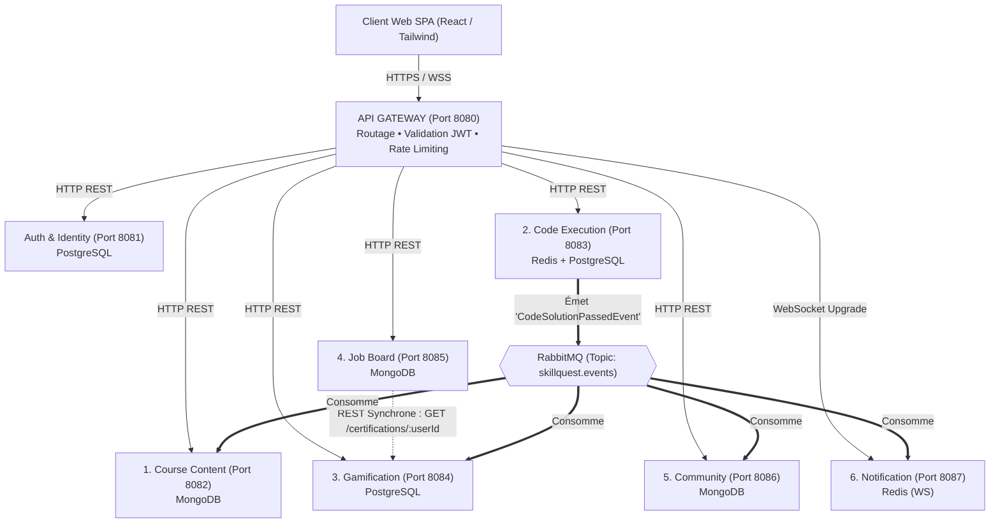
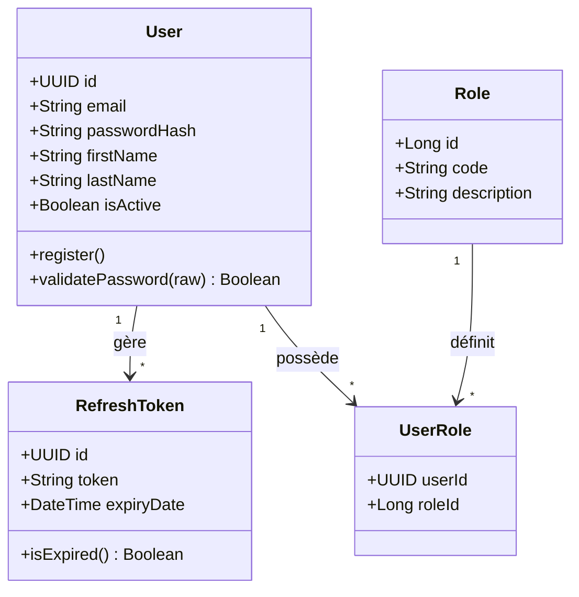
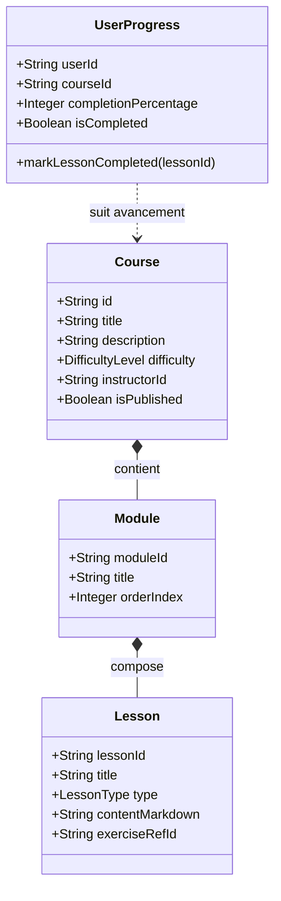
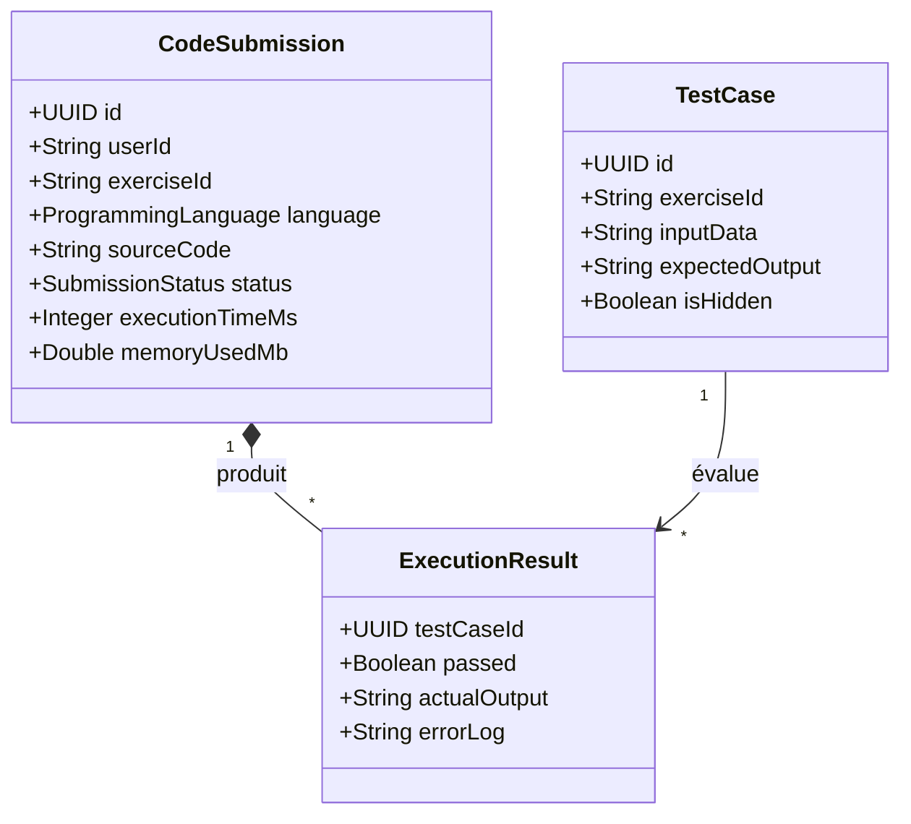
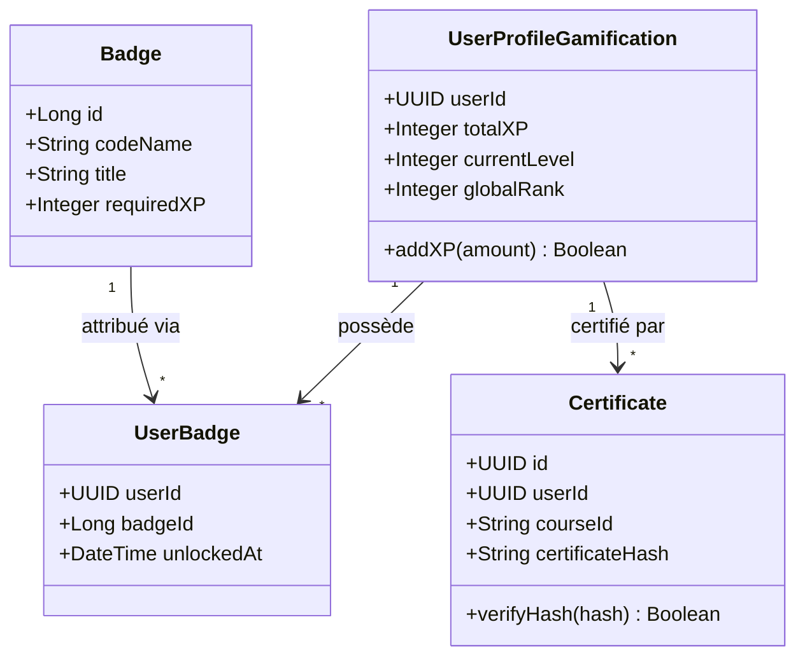
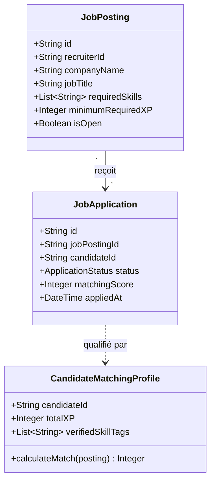
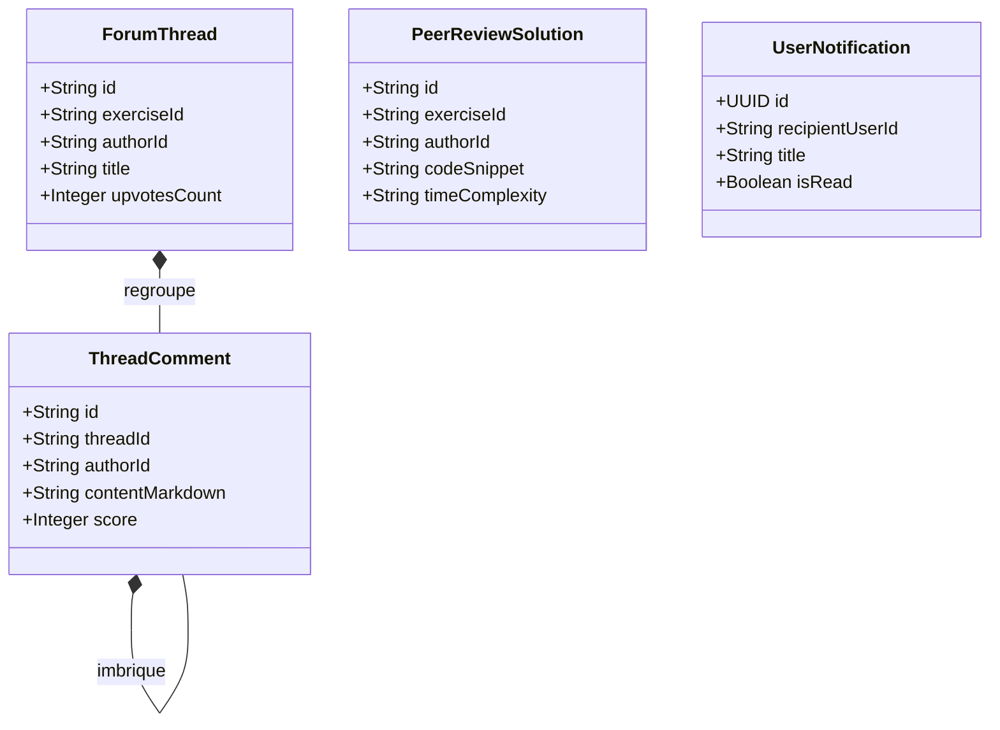

# SkillQuest – Soutenance Séance 4
## Architecture Web Distribuée (AWD) – Validation Intermédiaire

> **Classe :** [Votre Classe, ex: 4DAS16] | **Groupe :** [Votre Groupe, ex: G3]  
> **Dépôt Git :** https://github.com/Architecture-web/projet  
> **Durée totale estimée :** 12 à 15 minutes (Partie Collective ~5 min + Partie Individuelle ~6 min + Échanges ~10 min)

---

## 👥 Sommaire de la Soutenance

1. **Partie Collective (Présentée par l'ensemble de l'équipe – 5 min)**
   - Slide 1 : Problématique & Idée Générale
   - Slide 2 : Acteurs & Cas d'Utilisation
   - Slide 3 : Architecture Globale Proposée & API Gateway
   - Slide 4 : Stratégie des Données & Pattern Database-per-Service
   - Slide 5 : Communications Synchrones vs Asynchrones
   - Slide 6 : Sécurité & Gestion des Tokens JWT
   - Slide 7 : Organisation Git, Outils & Planning Prévisionnel
   - Slide 8 : Analyse des Risques & Mesures d'Atténuation
2. **Partie Individuelle (1 minute de parole par étudiant – 6 min)**
   - Étudiant 1 : Auth & Identity Service *(Service Commun)*
   - Étudiant 2 : Microservice 1 – Course & Content Service
   - Étudiant 3 : Microservice 2 – Code Execution & Sandbox Service
   - Étudiant 4 : Microservice 3 – Gamification & Certification Service
   - Étudiant 5 : Microservice 4 – Job Board & Recruitment Service
   - Étudiant 6 : Microservice 5 – Community & Notifications Service
3. **Conclusion & Échanges avec l'Enseignant (10 min)**

---

# 🌐 PARTIE COLLECTIVE (Équipe)

---

## 🎯 Slide 1 : Problématique & Idée Générale

### Constat Métier
- **Limites des CV classiques :** Un diplôme ou un CV traditionnel ne garantit pas la qualité réelle du code d'un candidat ni sa rigueur algorithmique.
- **Absence de preuves vérifiables :** Les étudiants manquent d'outils certifiants pour valoriser leurs acquis pratiques auprès des entreprises.
- **Silos applicatifs :** Les plateformes de cours (Coursera) sont déconnectées des sites d'entraînement au code (LeetCode) et des portails d'emploi.

### Solution Proposée : SkillQuest
Une plateforme web distribuée alliant :
1. **L'apprentissage modulaire** (*style Coursera*) avec leçons interactives et suivi de progression.
2. **L'évaluation de code en temps réel** (*style LeetCode*) exécuté dans une sandbox sécurisée sans réseau.
3. **Le recrutement certifié** par les compétences démontrées (badges infalsifiables et matching automatisé).

---

## 👤 Slide 2 : Acteurs & Cas d'Utilisation

| Acteur | Besoins & Actions principales |
| :--- | :--- |
| **Apprenant / Développeur** | S'inscrire, suivre des cours, soumettre du code dans l'éditeur, gagner des points d'XP, débloquer des badges et postuler à des offres. |
| **Instructeur / Auteur** | Rédiger les modules de formation, concevoir les exercices et paramétrer les jeux de tests unitaires (publics et cachés). |
| **Recruteur Tech** | Déposer des offres d'emploi, filtrer les candidats par compétences certifiées et inviter les meilleurs profils en entretien. |
| **Administrateur** | Modérer les cours et offres, superviser les quotas machine de la sandbox et gérer les accès RBAC. |

---

## 🏛️ Slide 3 : Architecture Globale Proposée

---

## 💾 Slide 4 : Stratégie des Données & Pattern Database-per-Service

- **Principe fondamental :** Aucun microservice n'accède directement à la base de données d'un autre service.
- **Approche Polyglotte :**
  - **PostgreSQL 15** : Intégrité relationnelle stricte (ACID) pour l'authentification (`skillquest_auth`), les transactions d'XP et les certificats (`skillquest_gamification`) et l'historique des soumissions (`skillquest_submissions`).
  - **MongoDB 6.0** : Modèle documentaire souple et arborescent pour les cours/leçons (`skillquest_courses`), les annonces de recrutement (`skillquest_jobs`) et les discussions (`skillquest_community`).
  - **Redis 7** : Traitement en mémoire ultra-rapide pour la file d'attente FIFO des soumissions de code et la gestion des sessions WebSockets actives.

---

## 🔄 Slide 5 : Communications Synchrones vs Asynchrones

### 1. Communications Synchrones (HTTP REST)
- Utilisées pour les consultations immédiates sans duplication de données.
- *Exemple :* Le `Job Board Service` appelle `GET /api/certifications/:userId` sur le `Gamification Service` pour valider les compétences réelles d'un candidat avant d'enregistrer sa postulation.

### 2. Communications Asynchrones (Event-Driven via RabbitMQ)
- Utilisées pour le découplage temporel et la propagation d'effets de bord sans bloquer le client.
- *Exemple :* À la réussite d'un exercice, `Code Execution Service` publie `CodeSolutionPassedEvent`. Cet événement est consommé en parallèle par :
  - `Gamification Service` $\rightarrow$ +50 XP et attribution de badge.
  - `Course Service` $\rightarrow$ Validation de la leçon dans le parcours de l'étudiant.
  - `Community Service` $\rightarrow$ Déblocage de l'accès à la Peer-Review.
  - `Notification Service` $\rightarrow$ Diffusion de l'alerte en direct via WebSocket.

---

## 🛡️ Slide 6 : Sécurité & Gestion des Tokens JWT

- **Authentification centralisée :** Émission par l'Auth Service d'un `access_token` JWT signé (durée : 15 min) et d'un `refresh_token` persistant (durée : 7 jours).
- **Validation périmétrique à la Gateway :**
  - L'API Gateway intercepte l'en-tête `Authorization: Bearer <token>`.
  - Vérifie la signature cryptographique et la validité temporelle.
  - Injecte les en-têtes internes sécurisés : `X-User-Id`, `X-User-Email` et `X-User-Role`.
- **Rôles applicatifs (RBAC) :** `ROLE_STUDENT`, `ROLE_INSTRUCTOR`, `ROLE_RECRUITER`, `ROLE_ADMIN`.

---

## 📅 Slide 7 : Organisation Git, Outils & Planning

- **Gestion du code source :**
  - Dépôt public avec enseignant invité en collaborateur : `https://github.com/Architecture-web/projet`.
  - Branche `main` protégée (uniquement du code stable testé).
  - Branches `feature/<service>` par microservice pour un développement parallèle sans conflit.
- **Méthodologie & Suivi :** Méthode Kanban sur **GitHub Projects** (To Do $\rightarrow$ In Progress $\rightarrow$ Review $\rightarrow$ Done).
- **Planning prévisionnel :**
  - *Séance 4 :* Validation intermédiaire de l'architecture, modèles et contrats d'API.
  - *Semaines 5-6 :* Développement unitaire de chaque microservice et de sa base.
  - *Semaines 7-8 :* Intégration de l'API Gateway, broker RabbitMQ et Frontend React.
  - *Semaine 9 :* Tests de charge de bout en bout, Docker final et soutenance.

---

## ⚠️ Slide 8 : Analyse des Risques & Mesures d'Atténuation

| Risque Identifié | Impact | Probabilité | Solution Préventive Mise en Place |
| :--- | :---: | :---: | :--- |
| **Exécution de code malveillant / boucle infinie** | Élevé | Moyenne | Sandbox Docker éphémère sans accès réseau, CPU bridé, mémoire max 128 Mo et timeout strict de 2 secondes. |
| **Désynchronisation des données inter-services** | Élevé | Faible | Contrats d'API stricts (OpenAPI), événements idempotents sur RabbitMQ et mécanisme de compensation. |
| **Retard d'intégration du Frontend client** | Moyen | Moyenne | Définition exhaustive des contrats d'API dès la séance 4 permettant aux devs frontend de travailler avec des mocks. |

---

# 🎤 PARTIE INDIVIDUELLE (1 minute par étudiant)

---

## 👤 ÉTUDIANT 1 : Service Commun – Auth & Identity Service (Port 8081)

### 1. Conception & Diagramme de Classes

### 2. Interactions & Exigences Techniques AWD
- **Communication Synchrone REST (Appel émis) :**
  - `POST http://localhost:8084/api/gamification/profiles`
  - *Justification :* Dès qu'un nouvel utilisateur s'inscrit, l'Auth Service sollicite en direct le service de Gamification pour lui créer son profil de joueur initialisé avec 0 XP avant son premier accès au dashboard.
- **Événement Métier Publié :**
  - `UserRegisteredEvent` sur le topic `auth.user.registered`.
  - *Payload :* `{ "userId": "usr_9823f4a1", "email": "sarah.benali@example.com", "role": "ROLE_STUDENT" }`.
- **Événement Métier Consommé :**
  - `UserReportedAbuseEvent` émis par `community-service` sur la queue `auth.abuse_reported.queue`.
  - *Action métier :* Si un compte fait l'objet de plus de 3 signalements graves, le service désactive automatiquement le compte (`isActive = false`).

### 3. Principaux Contrats d'API
| Méthode | Endpoint | Rôle | Code Succès |
| :--- | :--- | :--- | :---: |
| `POST` | `/api/auth/register` | Inscription d'un utilisateur | `201 Created` |
| `POST` | `/api/auth/login` | Authentification & délivrance JWT | `200 OK` |
| `POST` | `/api/auth/refresh` | Renouvellement du token expiré | `200 OK` |
| `GET` | `/api/auth/users/:id/summary` | Profil résumé (appelé par les autres services) | `200 OK` |

### 🎙️ Speech Oral Étudiant 1 (Chronométré 1 minute)
> *"Bonjour à tous. Je présente le service commun d'authentification et d'identité que nous avons conçu ensemble. Sa mission est d'assurer la gestion des utilisateurs, le hachage sécurisé des mots de passe en BCrypt et la distribution des tokens JWT avec contrôle d'accès RBAC. Nous avons choisi PostgreSQL pour garantir l'intégrité relationnelle et l'unicité stricte des adresses e-mails.*  
> *Sur le plan des interactions, dès qu'un compte est créé, mon service effectue un appel synchrone REST vers le Gamification Service pour initialiser son solde de points, puis publie l'événement UserRegisteredEvent sur RabbitMQ afin que le service de notifications expédie l'e-mail de confirmation.*  
> *En consommation, mon service écoute l'événement UserReportedAbuseEvent en provenance du service Community pour suspendre automatiquement les comptes signalés en cas d'abus. Merci."*

---

## 👤 ÉTUDIANT 2 : Microservice 1 – Course & Learning Content Service (Port 8082)

### 1. Conception & Diagramme de Classes

### 2. Interactions & Exigences Techniques AWD
- **Communication Synchrone REST (Appel émis) :**
  - `GET http://localhost:8081/api/auth/users/:instructorId/summary`
  - *Justification :* Lors de la création d'un cours par un instructeur (`POST /api/courses`), le service interroge en direct l'Auth Service pour certifier que l'utilisateur possède bien le rôle `ROLE_INSTRUCTOR` et est actif.
- **Événement Métier Publié :**
  - `CourseCompletedEvent` sur le topic `course.completion.completed`.
  - *Payload :* `{ "userId": "usr_9823f4a1", "courseId": "crs_java_adv_01", "completionDate": "2026-11-09T14:30:00Z" }`.
- **Événement Métier Consommé :**
  - `CodeSolutionPassedEvent` émis par `code-execution-service` sur `course.code_passed.queue`.
  - *Action métier :* Valide automatiquement la leçon pratique dans le document `UserProgress` et recalcule le pourcentage de complétion du cours.

### 3. Principaux Contrats d'API
| Méthode | Endpoint | Rôle | Code Succès |
| :--- | :--- | :--- | :---: |
| `GET` | `/api/courses` | Liste paginée des cours avec filtres | `200 OK` |
| `GET` | `/api/courses/:id` | Détail complet d'un cours et de son plan | `200 OK` |
| `POST` | `/api/courses` | Création d'une formation (Instructeur) | `201 Created` |
| `PUT` | `/api/courses/:id/progress` | Sauvegarde de l'avancement | `200 OK` |
| `GET` | `/api/courses/:id/exercises/:eId/test-cases` | Fournit les tests à la sandbox (interne) | `200 OK` |

### 🎙️ Speech Oral Étudiant 2 (Chronométré 1 minute)
> *"Bonjour. Je suis responsable du Course Content Service, le cœur pédagogique de SkillQuest. Il gère le catalogue des cours, la hiérarchie des modules et la persistance de l'avancement des apprenants. J'ai sélectionné MongoDB car sa structure documentaire en JSON est parfaite pour imbriquer des cours, des chapitres et des leçons polymorphes sans jointures relationnelles.*  
> *Pour mes interactions, j'émets un appel synchrone REST vers l'Auth Service pour valider le statut de l'instructeur lors du dépôt d'un cours. En asynchrone, je consomme CodeSolutionPassedEvent émis par la sandbox pour valider instantanément les leçons pratiques de l'élève.*  
> *Enfin, dès qu'un cours atteint 100% de complétion, mon service publie CourseCompletedEvent sur RabbitMQ pour déclencher l'émission du certificat officiel. Merci."*

---

## 👤 ÉTUDIANT 3 : Microservice 2 – Code Execution & Sandbox Service (Port 8083)

### 1. Conception & Diagramme de Classes

### 2. Interactions & Exigences Techniques AWD
- **Communication Synchrone REST (Appel émis) :**
  - `GET http://localhost:8082/api/courses/:courseId/exercises/:exerciseId/test-cases`
  - *Justification :* La sandbox ne stocke aucun énoncé ni test en dur. Avant de compiler le code, elle interroge le `course-service` en direct pour charger la liste à jour des assertions publiques et cachées.
- **Événement Métier Publié :**
  - `CodeSolutionPassedEvent` sur le topic `code.solution.passed`.
  - *Payload :* `{ "userId": "usr_9823f4a1", "exerciseId": "ex_binary_search_01", "executionTimeMs": 42, "memoryUsedMb": 28.5 }`.
- **Événement Métier Consommé :**
  - `ExerciseCreatedEvent` émis par `course-service` sur `code_exec.exercise_created.queue`.
  - *Action métier :* Pré-chauffe (*warm-up*) les conteneurs Docker et les runtimes de compilation (Java/Python) pour éviter toute latence lors de la première exécution d'un élève.

### 3. Principaux Contrats d'API
| Méthode | Endpoint | Rôle | Code Succès |
| :--- | :--- | :--- | :---: |
| `POST` | `/api/submissions/run` | Test rapide contre assertions publiques | `200 OK` |
| `POST` | `/api/submissions/submit` | Soumission sandbox complète (asynchrone) | `202 Accepted` |
| `GET` | `/api/submissions/:id` | Récupération du statut et des métriques | `200 OK` |

### 🎙️ Speech Oral Étudiant 3 (Chronométré 1 minute)
> *"Bonjour. Mon microservice est le moteur technique d'évaluation pratique de la plateforme. Il reçoit le code soumis par les étudiants et l'évalue dans une sandbox Docker éphémère totalement isolée : aucun accès réseau, mémoire bridée à 128 Mo et timeout dur de 2 secondes contre les boucles infinies. J'utilise Redis pour la file d'attente FIFO des soumissions et PostgreSQL pour l'historique pérenne des résultats.*  
> *Pour les échanges inter-services, j'interroge en direct le Course Service via REST pour charger les tests unitaires avant exécution. Dès qu'une soumission passe avec succès l'ensemble des tests cachés, je publie l'événement pivot CodeSolutionPassedEvent sur RabbitMQ.*  
> *En consommation, j'écoute ExerciseCreatedEvent pour pré-charger les environnements d'exécution à chaud. Merci."*

---

## 👤 ÉTUDIANT 4 : Microservice 3 – Gamification & Certification Service (Port 8084)

### 1. Conception & Diagramme de Classes

### 2. Interactions & Exigences Techniques AWD
- **Communication Synchrone REST (Appel émis & Appel reçu) :**
  - *Appel émis :* `GET http://localhost:8082/api/courses/:id` auprès de `course-service` pour obtenir le titre officiel du cours lors de la signature du certificat PDF.
  - *Appel reçu :* Expose `GET /api/certifications/:userId` sollicité en direct par le Job Board pour attester des compétences d'un candidat.
- **Événement Métier Publié :**
  - `BadgeUnlockedEvent` sur le topic `gamification.badge.unlocked`.
  - *Payload :* `{ "userId": "usr_9823f4a1", "badgeId": "bdg_algo_master", "badgeTitle": "Maître Algorithmique", "xpAwarded": 50 }`.
- **Événements Métiers Consommés :**
  - `CodeSolutionPassedEvent` (crédite +50 XP et vérifie le passage de niveau).
  - `CourseCompletedEvent` (déclenche la génération du certificat PDF officiel avec hash SHA-256).

### 3. Principaux Contrats d'API
| Méthode | Endpoint | Rôle | Code Succès |
| :--- | :--- | :--- | :---: |
| `GET` | `/api/gamification/leaderboard` | Top 50 des meilleurs codeurs par XP | `200 OK` |
| `GET` | `/api/gamification/badges/user/:id`| Badges débloqués par un élève | `200 OK` |
| `GET` | `/api/certifications/:userId` | Profil certifié (appelé par Job Board) | `200 OK` |
| `GET` | `/api/certifications/:id/verify`| Vérification publique du hash PDF | `200 OK` |

### 🎙️ Speech Oral Étudiant 4 (Chronométré 1 minute)
> *"Bonjour. Je suis en charge du Gamification & Certification Service, le moteur d'engagement de SkillQuest. Il gère la distribution des points d'XP, les badges de spécialité, le classement général et la génération de certificats PDF signés par un hash cryptographique vérifiable en ligne. J'ai choisi PostgreSQL pour garantir l'intégrité transactionnelle stricte et empêcher toute fraude aux scores.*  
> *Mon service écoute CodeSolutionPassedEvent pour créditer instantanément 50 XP. Quand un palier est franchi, il publie BadgeUnlockedEvent à destination du Job Board et des notifications.*  
> *En synchrone, je réponds aux requêtes REST du Job Board pour fournir les compétences certifiées du candidat, et j'interroge le Course Service pour récupérer les métadonnées officielles lors de l'émission d'un diplôme. Merci."*

---

## 👤 ÉTUDIANT 5 : Microservice 4 – Job Board & Recruitment Service (Port 8085)

### 1. Conception & Diagramme de Classes

### 2. Interactions & Exigences Techniques AWD
- **Communication Synchrone REST (Appel émis) :**
  - `GET http://localhost:8084/api/certifications/:candidateId`
  - *Justification :* Lors du dépôt d'une candidature (`POST /api/jobs/:id/apply`), le service contacte en temps réel le `gamification-service` pour valider les badges et l'XP certifiés du candidat sans stocker de doublons non synchronisés.
- **Événement Métier Publié :**
  - `JobApplicationSubmittedEvent` sur le topic `job.application.submitted`.
  - *Payload :* `{ "applicationId": "app_55419", "jobId": "job_94812", "candidateId": "usr_9823f4a1", "matchingScore": 94 }`.
- **Événement Métier Consommé :**
  - `BadgeUnlockedEvent` émis par `gamification-service` sur `job_board.badge_unlocked.queue`.
  - *Action métier :* Recalcule en tâche de fond les scores de matching des offres ouvertes pour ce profil et met à jour les suggestions personnalisées de l'étudiant.

### 3. Principaux Contrats d'API
| Méthode | Endpoint | Rôle | Code Succès |
| :--- | :--- | :--- | :---: |
| `POST` | `/api/jobs` | Dépôt d'une offre d'emploi (Recruteur) | `201 Created` |
| `GET` | `/api/jobs` | Recherche paginée des offres tech | `200 OK` |
| `GET` | `/api/jobs/matched` | Offres recommandées selon les badges | `200 OK` |
| `POST` | `/api/jobs/:id/apply` | Postulation certifiée (appel REST interne) | `201 Created` |

### 🎙️ Speech Oral Étudiant 5 (Chronométré 1 minute)
> *"Bonjour. Je suis responsable du Job Board & Recruitment Service. Ce service transforme les réussites académiques des étudiants en opportunités professionnelles réelles en automatisant le matching entre les offres d'entreprises et les badges techniques obtenus. J'ai opté pour MongoDB afin de modéliser des offres d'emploi riches avec indexation multi-critères sur les langages et compétences.*  
> *Lorsqu'un étudiant postule, mon service émet un appel synchrone REST vers le Gamification Service pour authentifier ses badges en temps réel et calculer son score d'adéquation.*  
> *Dès que la candidature est validée, je publie JobApplicationSubmittedEvent sur RabbitMQ pour alerter le recruteur. En consommation, j'écoute BadgeUnlockedEvent pour recalculer les offres suggérées dès qu'un élève monte en compétences. Merci."*

---

## 👤 ÉTUDIANT 6 : Microservice 5 – Community & Notifications Service (Ports 8086 & 8087)

### 1. Conception & Diagramme de Classes

### 2. Interactions & Exigences Techniques AWD
- **Communication Synchrone REST (Appel émis) :**
  - `GET http://localhost:8081/api/auth/users/:authorId/summary` auprès de `auth-service` pour afficher le nom et l'avatar de l'auteur d'un post sans dupliquer de table utilisateur.
- **Événements Métiers Publiés :**
  - `UserReportedAbuseEvent` sur `community.user.reported` (pour modération automatique).
  - `HelpfulCommentVotedEvent` sur `community.comment.upvoted`.
- **Événement Métier Consommé :**
  - `CodeSolutionPassedEvent` (Queue: `community.code_passed.queue`).
  - *Règle métier majeure :* L'accès aux solutions de la communauté (*Peer-Review*) est strictement verrouillé tant que l'élève n'a pas validé l'exercice lui-même. À la réception du message, le service débloque les droits de lecture et de partage de solutions pour cet élève.
  - Couplé avec le service de notification (Redis / WebSockets) pour diffuser les alertes live (`WS /ws/notifications`).

### 3. Principaux Contrats d'API
| Méthode | Endpoint | Rôle | Code Succès |
| :--- | :--- | :--- | :---: |
| `GET` | `/api/community/threads?exerciseId={id}` | Questions d'un exercice | `200 OK` |
| `POST` | `/api/community/threads` | Création d'une discussion | `201 Created` |
| `POST` | `/api/community/posts/:id/vote` | Voter (+1 / -1) pour une explication | `200 OK` |
| `GET` | `/api/community/exercises/:id/peer-reviews` | Solutions partagées (si validé) | `200 OK` |
| `WS` | `/ws/notifications` | Canal persistant d'alertes en direct | `101 Switching` |

### 🎙️ Speech Oral Étudiant 6 (Chronométré 1 minute)
> *"Bonjour. Je présente le Community Service ainsi que la couche transverse de notifications temps réel. Notre service favorise l'émulation collective grâce à des espaces de questions/réponses contextuels et un module exclusif de revue de code entre pairs. J'ai choisi MongoDB pour stocker l'arborescence des commentaires imbriqués et Redis pour maintenir les sessions WebSockets actives.*  
> *Pour mes interactions, j'appelle en REST synchrone l'Auth Service pour afficher l'identité de l'auteur sans dupliquer ses données personnelles. En asynchrone, je consomme CodeSolutionPassedEvent : tant qu'un étudiant n'a pas résolu un défi, l'accès aux solutions des pairs lui est bloqué pour éviter le spoil.*  
> *Enfin, je publie UserReportedAbuseEvent vers l'Auth Service en cas d'abus signalé et je route les alertes instantanées vers le navigateur de l'élève. Merci."*

---

## 🏁 Slide Finale : Conclusion & Bilan

- **Architecture robuste & résiliente :** Découplage strict via **Database-per-Service** et isolation des charges avec RabbitMQ.
- **Conformité totale aux exigences :** Chaque membre a conçu son microservice, justifié son stockage, et implémenté au moins 1 communication REST, 1 publication et 1 consommation d'événement.
- **Prêt pour l'implémentation (Séances 5 à 9) :** Modèles de données, diagrammes UML et contrats d'API validés.
